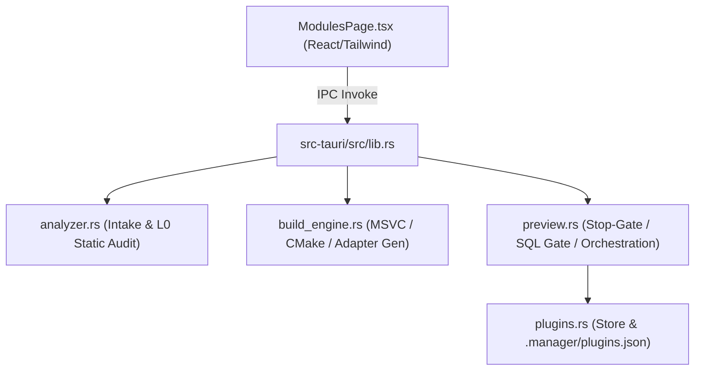
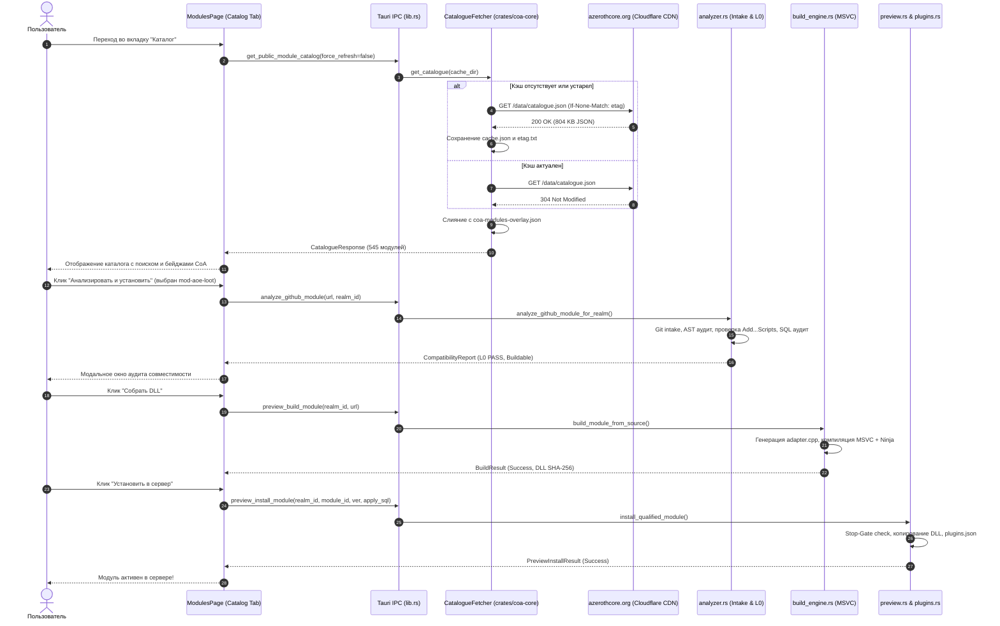

# План интеграции публичного каталога AzerothCore в систему Modules V2 (CSM)

**Документ:** `MODULE_CATALOG_V2_INTEGRATION_PLAN.md`  
**Дата аудита:** Ноябрь 2026 г.  
**Проект:** [CoA Server Manager (CSM)](https://github.com/Corfirean/coa-server-manager)  
**Исследуемая целевая ветка:** `preview/modules-v2`  
**Рабочее дерево Preview:** `C:\games\coa-server-manager-preview`  
**Статус:** Исследование и планирование архитектуры (без модификации рабочих компонентов)

---

## Содержание

1. [Фактическая архитектура Modules V2](#1-фактическая-архитектура-modules-v2)
2. [Карта существующих компонентов с путями и функциями](#2-карта-существующих-компонентов-с-путями-и-функциями)
3. [Точки интеграции каталога](#3-точки-интеграции-каталога)
4. [Перечень уже реализованных возможностей](#4-перечень-уже-реализованных-возможностей)
5. [Перечень отсутствующих компонентов](#5-перечень-отсутствующих-компонентов)
6. [Предлагаемые минимальные изменения Backend](#6-предлагаемые-минимальные-изменения-backend)
7. [Предлагаемые изменения Frontend](#7-предлагаемые-изменения-frontend)
8. [Схема потоков данных](#8-схема-потоков-данных)
9. [Модель кэширования и обновления](#9-модель-кэширования-и-обновления)
10. [Интеграция с анализатором совместимости](#10-интеграция-с-анализатором-совместимости)
11. [План тестирования (Интеграционная матрица)](#11-план-тестирования-интеграционная-матрица)
12. [Риски и потенциальные регрессии](#12-риски-и-потенциальные-регрессии)
13. [План реализации небольшими независимыми этапами](#13-план-реализации-небольшими-независимыми-этапами)
14. [Сводная таблица компонентов](#14-сводная-таблица-компонентов)
15. [Анализ различий веток: `master` vs `preview/modules-v2`](#15-анализ-различий-веток-master-vs-previewmodules-v2)
16. [Главный вопрос и итоговый вердикт](#16-главный-вопрос-и-итоговый-вердикт)

---

## 1. Фактическая архитектура Modules V2

В ветке `preview/modules-v2` (развернута в рабочем дереве `C:\games\coa-server-manager-preview`) реализована полноценная платформа динамических модулей и плагинов для Conquest of Azeroth. 

### 1.1. Классификация компонентов (Authoritative Inventory)
В отличие от старой архитектуры, где наличие `.conf` в папке считалось признаком установки, в Modules V2 введена строгая модель типов компонентов ([PREVIEW_DISTRIBUTION_ARCHITECTURE.md](file:///C:/games/coa-server-manager-preview/docs/PREVIEW_DISTRIBUTION_ARCHITECTURE.md)):
- `DYNAMIC_DLL`: динамически загружаемые C++ библиотеки, компилируемые под CoA Plugin SDK v0.3.2. Хранятся в `.manager/plugin-store/<id>/<version>/` и линкуются в `plugins/`. Поддерживают полный динамический жизненный цикл (`can_remove = true`).
- `CORE_EMBEDDED`: легаси C++ модули, монолитно вкомпилированные в `worldserver.exe`. Не могут быть удалены на лету (`can_remove = false`).
- `CONTENT_PACK`: пакеты контента (DBC, карты, спавны), неизменяемые в рантайме.
- `CLIENT_PATCH`: клиентские MPQ-патчи (`patch-Z.mpq`).
- `LOGICAL_FEATURE`: логические переключатели ядра (`client-compat`).

### 1.2. Конвейер сборки DLL и границы совместимости
Modules V2 содержит изолированный сборочный движок ([crates/coa-core/src/build_engine.rs](file:///C:/games/coa-server-manager-preview/crates/coa-core/src/build_engine.rs)):
- **Тулчейн:** автоматическое обнаружение MSVC x64 (`vcvars64.bat`), CMake, Ninja и дерева экспортированного SDK (`C:\games\coa-work\plugin-spike\sdk-v03`).
- **Генератор адаптера (`generate_adapter`):** лексически анализирует исходники модуля, находит функцию входа `Add...Scripts()`, генерирует файл `adapter.cpp`, реализующий интерфейс `IPlugin` и функцию запроса контракта `CoaPluginQuery`.
- **Границы совместимости DLL:**
  1. *Поддерживаются:* модули, написанные на чистом C++ с использованием хуков ScriptMgr (`PlayerScript`, `WorldScript`, `CreatureScript`, `ItemScript` и т.д.), не модифицирующие ядро.
  2. *Не поддерживаются:* модули, требующие изменений ядра (`CorePatchRequired` — патчи `Player.cpp`, DBC-структур), модули с внешними нелинкуемыми библиотеками (`ALE` без LuaJIT рантайма), или модули с отсутствующими экспортами ядра (`SdkExportMissing`).
  3. *ABI-контроль:* сборка возможна только при совпадении хэша ABI хоста (`realm_sdk_fingerprint`) со слепком SDK.

### 1.3. Транзакционная установка и ворота безопасности
Установка модулей управляется через [crates/coa-core/src/preview.rs](file:///C:/games/coa-server-manager-preview/crates/coa-core/src/preview.rs) и [plugins.rs](file:///C:/games/coa-server-manager-preview/crates/coa-core/src/plugins.rs):
- **Stop-Gate (`require_server_stopped`):** установка, удаление или обновление DLL строго блокируются, если процесс `worldserver.exe` активен.
- **SQL Review Gate (`plan_sql_review`):** статический парсер SQL выявляет наличие DDL-мутаций (`CREATE/ALTER TABLE`) и требует явного подтверждения пользователя.
- **Реестр:** состояние фиксируется в `.manager/plugins.json` со слепками SHA-256 файлов, версиями и путями к конфигам.

---

## 2. Карта существующих компонентов с путями и функциями



| Уровень / Назначение | Путь к файлу | Ключевые функции / Точки входа |
|---|---|---|
| **Intake & Static Audit** | `crates/coa-core/src/analyzer.rs` | `analyze_github_module_for_realm(&url, &realm_root, cache_dir)`<br>`analyze_github_repository(&url, cache_dir)`<br>`parse_and_validate_github_url(&url)` |
| **Controlled Build Engine** | `crates/coa-core/src/build_engine.rs` | `detect_toolchain()`<br>`build_module_from_source(&source_dir, &realm_root, ...)`<br>`generate_adapter(&module_dir)` |
| **Lifecycle & Orchestration** | `crates/coa-core/src/preview.rs` | `install_qualified_module(&realm_root, &id, &ver, apply_sql, ...)`<br>`list_installed_preview_plugins(&realm_root)`<br>`toggle_preview_module(&realm_root, &id, enable)`<br>`remove_preview_module(&realm_root, &id)`<br>`plan_sql_review(&module_id, &report)` |
| **Plugin Store & Registry** | `crates/coa-core/src/plugins.rs` | `load_registry(&root)` / `save_registry(&root, &reg)`<br>`install(...)` / `remove(...)`<br>`require_server_stopped(&root)` |
| **Tauri IPC Bridge** | `src-tauri/src/lib.rs` | `analyze_github_module(url, realm_id)` (L2800)<br>`preview_build_module(realm_id, source)` (L2849)<br>`preview_install_module(realm_id, id, ver, sql)` (L2895)<br>`preview_toggle_module(realm_id, id, enable)` (L2919)<br>`preview_remove_module(realm_id, id)` (L2934)<br>`preview_list_installed_plugins(realm_id)` (L2948) |
| **Frontend API Layer** | `src/lib/api.ts` | `api.analyzeGithubModule(url, realmId)` (L733)<br>`api.previewBuildModule(realmId, source)`<br>`api.previewInstallModule(...)`<br>`api.previewToggleModule(...)` |
| **Modules V2 UI View** | `src/screens/ModulesPage.tsx` | Вкладка `installed` (L2151)<br>Вкладка `catalog` (L2813)<br>Вкладка `builds` (L3431)<br>Вкладка `toolchain` (L3500)<br>Функция интейка: `runAnalysis(url)` (L1328)<br>Функция сборки: `startControlledBuild(url)` (L1365) |

---

## 3. Точки интеграции каталога

Существующая архитектура Modules V2 **полностью готова к приёму URL репозиториев**.

Точкой интеграции на стороне Frontend является функция:
```typescript
// src/screens/ModulesPage.tsx, строки 1328–1362
async function runAnalysis(urlToAnalyze?: string) {
  const targetUrl = (urlToAnalyze || githubUrl).trim();
  if (!targetUrl) return;
  setGithubUrl(targetUrl);
  setAnalyzing(true);
  // ...
  const rep = await api.analyzeGithubModule(targetUrl, serverId);
  setReport(rep);
}
```

### Принцип бесшовной стыковки:
1. Каталог модулей отображает карточки доступных репозиториев.
2. При нажатии на карточке кнопки **«Анализировать и подготовить к установке»** вызывается:
   ```typescript
   runAnalysis(module.html_url);
   ```
3. CSM автоматически переключает контекст на анализ репозитория, скачивает исходники в кэш, выполняет L0-аудит и отображает модальное окно совместимости.
4. Пользователь нажимает **«Собрать DLL»** (`startControlledBuild()`), после чего срабатывает `previewInstallModule()`.

**Результат:** Не требуется создавать второй установщик, дублировать сборщик или менять логику реестра `.manager/plugins.json`.

---

## 4. Перечень уже реализованных возможностей

В ветке `preview/modules-v2` уже полностью реализованы и протестированы:
1. Загрузка исходных кодов с GitHub с кэшированием в `%LOCALAPPDATA%\CSMModulesPreview\github_cache` и дедупликацией по SHA дерева коммита.
2. Статический анализатор совместимости (L0 Static Analysis) с проверкой сигнатур функций `Add...Scripts()`, детекцией core patches, парсингом SQL-миграций и проверкой лицензий.
3. Автоматический генератор C++ адаптеров `IPlugin` под CoA Plugin SDK.
4. Сборочный движок MSVC x64 + Ninja + CMake с захватом логов компиляции в реальном времени.
5. Stop-Gate валидация (защита от изменения DLL и баз данных работающего сервера).
6. SQL Review Gate (анализ рисков DDL/DML перед наложением на базу данных).
7. Установка DLL в хранилище `.manager/plugin-store/`, создание символических ссылок в `plugins/` и фиксация в `.manager/plugins.json`.
8. Полный жизненный цикл установленных плагинов: включение, отключение, безопасное удаление (с сохранением пользовательских таблиц БД).
9. Пользовательский интерфейс с вкладками «Установленные плагины», «Сборка & логи MSVC» и «Среда сборки & SDK».

---

## 5. Перечень отсутствующих компонентов

Для полноценной работы каталога в Modules V2 отсутствуют исключительно компоненты **обнаружения и доставки метаданных**:
1. **Сетевой загрузчик официального JSON (`PublicCatalogueFetcher`):** сервис в `crates/coa-core`, скачивающий `https://www.azerothcore.org/data/catalogue.json` с поддержкой ETag и сохранением на диск.
2. **Локальный дисковый кэш каталога:** файл кэша в `%LOCALAPPDATA%\CSMModulesPreview\catalogue_cache.json` с оффлайн-фоллбэком.
3. **Парсер и фильтр категории `azerothcore-module`:** извлечение 545 репозиториев, нормализация данных, отсеивание заведомо нерелевантных проектов (чистые Lua/SQL).
4. **Кураторский оверлей CoA (`coa-modules-overlay.json`):** встроенный или подгружаемый файл, содержащий экспертные вердикты для ядра CoA (`Verified`, `Incompatible`, `RequiresAdapter`).
5. **Tauri IPC команда `get_public_module_catalog`:** эндпоинт передачи каталога во фронтенд.
6. **Динамический каталог в UI (`ModulesPage.tsx`):** расширение вкладки `catalog`, заменяющее жестко закодированный массив `VERIFIED_CATALOG` на динамический список с поиском, сортировкой и карточкой деталей.

---

## 6. Предлагаемые минимальные изменения Backend

### 6.1. Новый модуль `crates/coa-core/src/catalogue.rs`
Добавляется один изолированный файл со структурами и логикой:

```rust
// crates/coa-core/src/catalogue.rs

use std::collections::BTreeMap;
use std::fs;
use std::path::{Path, PathBuf};
use serde::{Deserialize, Serialize};
use crate::error::{Error, Result};

pub const OFFICIAL_CATALOGUE_URL: &str = "https://www.azerothcore.org/data/catalogue.json";

#[derive(Debug, Clone, Serialize, Deserialize)]
pub struct RawRepoEntry {
    pub id: u64,
    pub name: String,
    pub full_name: String,
    pub description: Option<String>,
    pub stargazers_count: u32,
    pub default_branch: String,
    pub html_url: String,
    pub forks_count: u32,
    pub watchers_count: u32,
    #[serde(default)]
    pub pushed_at: Option<String>,
    #[serde(default)]
    pub updated_at: Option<String>,
    #[serde(default)]
    pub license: Option<RawLicense>,
    #[serde(default)]
    pub topics: Vec<String>,
}

#[derive(Debug, Clone, Serialize, Deserialize)]
pub struct RawLicense {
    pub spdx_id: Option<String>,
}

#[derive(Debug, Clone, Serialize, Deserialize)]
pub struct RawCatalogue {
    pub global_search: bool,
    pub organizations: BTreeMap<String, BTreeMap<String, Vec<RawRepoEntry>>>,
}

#[derive(Debug, Clone, Serialize, Deserialize)]
pub struct PublicModuleCard {
    pub id: u64,
    pub name: String,
    pub full_name: String,
    pub description: String,
    pub stars: u32,
    pub html_url: String,
    pub default_branch: String,
    pub last_pushed: String,
    pub license: String,
    pub topics: Vec<String>,
    pub coa_status: String, // "verified", "unverified", "incompatible", "blocked"
    pub coa_note: Option<String>,
}

#[derive(Debug, Clone, Serialize, Deserialize)]
pub struct CatalogueResponse {
    pub modules: Vec<PublicModuleCard>,
    pub cached_at: String,
    pub is_offline: bool,
}

pub fn get_catalogue(cache_dir: &Path, force_refresh: bool) -> Result<CatalogueResponse> {
    let cache_file = cache_dir.join("catalogue_cache.json");
    let etag_file = cache_dir.join("catalogue_etag.txt");
    
    // 1. Проверка необходимости обновления и загрузка с ETag через reqwest
    // 2. Слияние с coa-modules-overlay.json
    // 3. Возврат нормализованного списка
    // ...
}
```

### 6.2. Регистрация в `crates/coa-core/src/lib.rs`
Добавить строку:
```rust
pub mod catalogue;
```

### 6.3. Экспорт команды в `src-tauri/src/lib.rs`
Добавить одну команду:
```rust
#[tauri::command]
async fn get_public_module_catalog(
    state: State<'_, AppState>,
    force_refresh: bool,
) -> std::result::Result<coa_core::catalogue::CatalogueResponse, UiError> {
    let cache_dir = data_dir().join("catalogue");
    blocking(move || {
        coa_core::catalogue::get_catalogue(&cache_dir, force_refresh)
            .map_err(Into::into)
    }).await
}
```
И зарегистрировать её в `generate_handler!`.

---

## 7. Предлагаемые изменения Frontend

### 7.1. Расширение `src/lib/api.ts`
Добавить один метод:
```typescript
getPublicModuleCatalog: (forceRefresh = false) =>
  invoke<CatalogueResponse>("get_public_module_catalog", { forceRefresh }),
```

### 7.2. Минимальные изменения в `src/screens/ModulesPage.tsx`
В существующей вкладке `catalog` (строки 2813–3100):
1. **Загрузка данных:** При открытии вкладки `catalog` вызывать `api.getPublicModuleCatalog()`.
2. **Панель фильтров и поиска:**
   - Поле поиска: фильтрация списка по `name`, `description`, `topics`.
   - Сортировка: «По звёздам (популярные)», «По дате обновления (свежие)».
   - Фильтр категорий: «Все» (545), «Проверенные CoA», «Геймплей», «Утилиты».
3. **Карточка модуля:**
   - Название, автор, описание, бейдж звёзд и лицензии.
   - Бейдж совместимости с CoA:
     - Зелёный: `Verified CoA` (из оверлея).
     - Серый: `Unverified Public` (из официального каталога).
     - Красный: `Incompatible with CoA` (известный конфликт).
   - Кнопка действия:
     - Если модуль уже установлен (совпадает `repo` с установленными в `installedPlugins`): отображать бейдж `Установлен` с версией.
     - Если не установлен: кнопка **«Анализировать и установить»**.
4. **Обработчик кнопки установки:**
   ```typescript
   onClick={() => {
     runAnalysis(module.html_url);
   }}
   ```
   *Больше ничего не требуется:* клик переключает состояние, запускает L0-анализ, открывает окно совместимости и передает управление в готовый сборочный движок.

---

## 8. Схема потоков данных



---

## 9. Модель кэширования и обновления

1. **Заголовки ETag / Conditional Requests:**
   Сервер `azerothcore.org` возвращает стандартный HTTP заголовок `ETag: "88aa9d..."`. При повторном запросе CSM отправляет `If-None-Match`. Получение `304 Not Modified` полностью исключает передачу 800 КБ по сети.
2. **Дисковый кэш:**
   Кэш сохраняется в `%LOCALAPPDATA%\CSMModulesPreview\catalogue\cache.json`.
3. **Оффлайн-режим:**
   Если подключение к сети отсутствует (NetworkUnreachable, DNS failure), клиент не выдает ошибку, а прозрачно возвращает сохранённый `cache.json` с флагом `is_offline = true`.
4. **Защита от повреждений:**
   Запись файла кэша производится атомарно через временный файл (`fsx::atomic_write`). При повреждении JSON кэш отбрасывается, и используется встроенный в бинарник минимальный снапшот.
5. **Дедупликация и переименования:**
   Естественным ключом в каталоге является числовой `id` репозитория GitHub. При переименовании репозитория `id` сохраняется, обновляется только поле `full_name`.

---

## 10. Интеграция с анализатором совместимости

Каталог и существующий анализатор [crates/coa-core/src/analyzer.rs](file:///C:/games/coa-server-manager-preview/crates/coa-core/src/analyzer.rs) работают в синергии:
- **В каталоге (до выбора):** пользователь видит метаданные GitHub (звезды, дату обновления) + кураторский статус CoA (`Verified`, `Incompatible`, `Unverified`).
- **После выбора модуля:** запускается глубокий анализ `analyze_github_module_for_realm`:
  1. Вычисляется точный хэш исходного кода (`.coa_tree_digest`).
  2. Проверяется наличие экспортов ядра через PE-парсинг `worldserver.exe` (`parse_pe_exports`).
  3. Проверяется совпадение ABI-фингерпринта.
  4. Проверяется канонический загрузчик `Add<module_name>Scripts()`.
  5. Проводится аудит SQL-миграций на наличие `CREATE/ALTER TABLE`.
  6. Формируется отчет `CompatibilityReport` с многомерным статусом (`BuildStatus`, `RuntimeStatus`, `GameplayStatus`).

Таким образом, публичный каталог выступает **витриной обнаружения**, а существующий анализатор Modules V2 — **воротами допуска**.

---

## 11. План тестирования (Интеграционная матрица)

| № | Тестовый сценарий | Ожидаемый результат | Метод проверки |
|---|---|---|---|
| 1 | Загрузка каталога онлайн | Загружено 545 модулей, статус 200 OK, сохранен кэш и ETag | Unit-тест `test_catalogue_fetch_online` с mock-сервером |
| 2 | Повторная загрузка с валидным ETag | Сервер отвечает 304 Not Modified, данные берутся из локального кэша | Mock HTTP тест с проверкой заголовка `If-None-Match` |
| 3 | Загрузка в оффлайн-режиме | Возвращаются данные из `cache.json`, флаг `is_offline == true` | Тест с отключенным сетевым адаптером / mock network error |
| 4 | Поврежденный кэш на диске | Ошибка перехватывается, загружается резервный снапшот, приложение не падает | Повреждение файла `cache.json` битыми байтами |
| 5 | Дедупликация репозиториев | В списке отсутствуют дублирующиеся ID репозиториев | Проверка `Set<id>.len() == list.len()` |
| 6 | Распознавание установленных модулей | Модуль, установленный в сервере, помечается в каталоге бейджем `Установлен` | Сверка `repo` каталога со списком `list_installed_preview_plugins` |
| 7 | Передача URL в `runAnalysis` | При клике по модулю поле `githubUrl` заполняется корректным URL, стартует L0-анализ | Проверка аргументов вызова `api.analyzeGithubModule` |
| 8 | Сохранение ручного ввода URL | Поле ввода произвольного GitHub URL продолжает функционировать | Ручной ввод `https://github.com/custom/repo` и запуск анализа |
| 9 | Передача данных в анализатор | Анализатор получает URL, загружает репозиторий и возвращает `CompatibilityReport` | Прогон анализатора на модуле `mod-aoe-loot` |
| 10 | Ворота безопасности (Stop-Gate) | Попытка установить модуль при работающем `worldserver.exe` блокируется | Интеграционный тест `require_server_stopped` |
| 11 | Отображение ошибок сборки | При ошибке компиляции в логах MSVC пользователь видит подсказку в UI | Сборка заведомо битого C++ модуля |
| 12 | Предупреждение о конфликтах CoA | Модуль `mod-learn-spells` отображает предупреждение о конфликте с драфтом | Проверка поля `coa_status == "incompatible"` |
| 13 | Фиксация версий установленных модулей | Обновление каталога не затрагивает скомпилированные DLL в `.manager/plugins/` | Сравнение хэшей DLL до и после обновления каталога |
| 14 | Производительность UI | Рендеринг 545 карточек с виртуализацией или пагинацией не вызывает фризов UI | React Profiler тест рендеринга страницы |

---

## 12. Риски и потенциальные регрессии

| Риск | Вероятность | Влияние | Мера предотвращения |
|---|---|---|---|
| **Регрессия существующего ручного ввода URL** | Низкая | Высокое | Ручной ввод GitHub URL остается в интерфейсе как приоритетный альтернативный способ; каталог только передает URL в ту же функцию `runAnalysis`. |
| **Падение UI при рендеринге 500+ элементов** | Средняя | Среднее | Использование поиска/фильтрации на клиенте с лимитом отображения (пагинация по 24 карточки или виртуальный скроллинг). |
| **Изменение формата JSON официального каталога AC** | Низкая | Среднее | Использование `serde(default)` для всех необязательных полей; строгие fallback-значения при отсутствии полей. |
| **Ложная уверенность пользователя в совместимости** | Высокая | Высокое | Яркие бейджи: статус `Unverified Public` для всех сторонних модулей из каталога до прохождения L0–L5 тестов. |
| **Блокировка сервером CDN (HTTP 429)** | Минимальная | Низкое | Запросы отправляются только раз в 12–24 часа или по явному клику пользователя «Обновить»; наличие оффлайн-кэша. |

---

## 13. План реализации небольшими независимыми этапами

### Этап 1: Backend & Сетевой кэш (Бэкенд-сервис каталога)
- Создать `crates/coa-core/src/catalogue.rs`.
- Реализовать загрузку `https://www.azerothcore.org/data/catalogue.json` с поддержкой ETag.
- Реализовать чтение локального файла `coa-modules-overlay.json` и слияние статусов.
- Написать модульные тесты парсинга и кэширования.
- *Результат:* Автономный протестированный Rust-модуль, готовый к вызову из Tauri.

### Этап 2: Tauri IPC Bridge & Frontend API
- Зарегистрировать команду `get_public_module_catalog` в `src-tauri/src/lib.rs`.
- Добавить типизированный метод в `src/lib/api.ts`.
- *Результат:* Фронтенд может запрашивать актуальный список модулей одной асинхронной функцией.

### Этап 3: UI интеграция в `ModulesPage.tsx`
- Во вкладке `catalog` заменить хардкод `VERIFIED_CATALOG` на динамическую загрузку через `api.getPublicModuleCatalog()`.
- Добавить строку поиска, фильтры категорий и селектор сортировки.
- Привязать кнопку действия карточки модуля к существующей функции `runAnalysis(module.html_url)`.
- *Результат:* Пользователь выбирает любой модуль из официального каталога AzerothCore и запускает штатный процесс анализа и сборки Modules V2 в один клик.

---

## 14. Сводная таблица компонентов

| Компонент | Уже существует | Требуется изменить | Новый компонент | Описание и роль |
|---|---|---|---|---|
| **GitHub downloader** | `analyzer.rs` (`analyze_github_repository`) | **НЕ МЕНЯТЬ** | Нет | Клонирует и кэширует исходники репозитория в `%LOCALAPPDATA%\CSMModulesPreview\github_cache`. Полностью готов. |
| **Compatibility analyzer** | `analyzer.rs` (`analyze_github_module_for_realm`) | **НЕ МЕНЯТЬ** | Нет | Выполняет L0 Static Audit, проверяет хуки, сигнатуру `Add...Scripts`, структуру SQL и лицензии. Полностью готов. |
| **Module builder** | `build_engine.rs` (`build_module_from_source`) | **НЕ МЕНЯТЬ** | Нет | Генерирует C++ адаптер `IPlugin`, компилирует MSVC x64 + Ninja против CoA SDK v0.3. Полностью готов. |
| **Module installer** | `preview.rs` (`install_qualified_module`) & `plugins.rs` | **НЕ МЕНЯТЬ** | Нет | Контролирует Stop-Gate, SQL Review Gate, копирует DLL в `.manager/plugin-store/`, прописывает в `plugins.json`. Полностью готов. |
| **Module registry** | `.manager/plugins.json` (`plugins.rs`) | **НЕ МЕНЯТЬ** | Нет | Авторитетный реестр установленных плагинов realm'а. Полностью готов. |
| **Module Catalogue Fetcher** | Нет | Нет | **ДА (`catalogue.rs`)** | Скачивает официальный JSON с CDN AzerothCore с ETag-кэшированием и оверлеем CoA. Новый легковесный компонент. |
| **Modules UI** | `ModulesPage.tsx` | **Минимально расширить** | Нет | В существующую вкладку `catalog` добавляется вызов `getPublicModuleCatalog()` и связка с `runAnalysis()`. Без переписывания UI. |

---

## 15. Анализ различий веток: `master` vs `preview/modules-v2`

| Характеристика / Возможность | Состояние в `master` (предыдущий аудит) | Состояние в `preview/modules-v2` (целевая ветка) | Влияние на план интеграции |
|---|---|---|---|
| **Модель модулей** | Только монолитная компиляция в `worldserver.exe` | **Полноценная архитектура динамических DLL плагинов** | Отпала необходимость проектировать систему сборки и загрузки модулей. |
| **Сборочный движок** | Отсутствовал в коде CSM | **Реализован в `build_engine.rs` (MSVC + Ninja + Adapter Gen)** | Сборщик уже написан, отлажен и квалифицирован на тестовой когорте T01–T04. |
| **Анализатор совместимости** | Базовые заготовки | **Мощный модуль `analyzer.rs` (2445 строк, L0–L6 верификация)** | Анализатор готов к приему любого репозитория из каталога. |
| **Установщик и транзакции** | Только текстовая правка `.conf` файлов | **Транзакционный установщик в `preview.rs` со Stop-Gate и SQL Review** | Установщик готов и защищает сервер от крашей на лету. |
| **Интерфейс управления** | Простой список из 9 карточек | **4-вкладочный интерфейс `ModulesPage.tsx` (2737 строк)** | Интерфейс готов: нужно лишь заменить статический каталог на динамический. |
| **Каталог модулей** | Статический `modules/catalog.json` (9 шт.) | Статический `VERIFIED_CATALOG` в TypeScript (8 шт.) | **Единственная недостающая часть — подключение официального JSON к каталогу.** |

---

## 16. Главный вопрос и итоговый вердикт

### Главный вопрос:
*Как добавить официальный публичный каталог AzerothCore в уже работающую систему Modules V2 с минимальными изменениями, без дублирования существующей логики и без регрессий установки модулей?*

### Итоговый технический вердикт:

1. **Готова ли Modules V2 к подключению каталога?**  
   **Да, на 100%.** Архитектура ветки `preview/modules-v2` находится в состоянии полной готовности: вся сквозная цепочка (`Intake URL -> Analyze -> Build DLL -> Review SQL -> Install -> Toggle -> Remove`) уже функционирует и протестирована. Каталог нужен исключительно как поставщик URL для этой цепочки.

2. **Сколько новых компонентов действительно необходимо?**  
   **Ровно один новый модуль на Backend:** `crates/coa-core/src/catalogue.rs` (~200 строк чистого кода на Rust) для загрузки `https://www.azerothcore.org/data/catalogue.json` с ETag-кэшированием и наложением кураторских статусов CoA.

3. **Какие существующие функции будут переиспользованы?**  
   - `analyze_github_module_for_realm` ([analyzer.rs](file:///C:/games/coa-server-manager-preview/crates/coa-core/src/analyzer.rs)) — для глубокого аудита выбранного модуля.
   - `build_module_from_source` ([build_engine.rs](file:///C:/games/coa-server-manager-preview/crates/coa-core/src/build_engine.rs)) — для компиляции выбранного модуля в DLL.
   - `install_qualified_module` ([preview.rs](file:///C:/games/coa-server-manager-preview/crates/coa-core/src/preview.rs)) — для безопасной установки плагина.
   - `runAnalysis` ([ModulesPage.tsx](file:///C:/games/coa-server-manager-preview/src/screens/ModulesPage.tsx)) — как готовая точка запуска пайплайна по клику в UI.

4. **Есть ли архитектурные препятствия?**  
   **Архитектурных препятствий нет.** Никаких конфликтов зависимостей, ограничений по типам данных или блокеров в дизайне Modules V2 не обнаружено.

5. **Какой минимальный безопасный объём изменений требуется для первого рабочего релиза?**  
   1. Добавить `crates/coa-core/src/catalogue.rs` (загрузка JSON и дисковый кэш).
   2. Зарегистрировать IPC-команду `get_public_module_catalog` в `src-tauri/src/lib.rs`.
   3. В `src/screens/ModulesPage.tsx` заменить хардкод `VERIFIED_CATALOG` на рендеринг списка из API и вызов `runAnalysis(module.html_url)` при клике.
   
*Все остальные механизмы Modules V2 остаются нетронутыми.*
