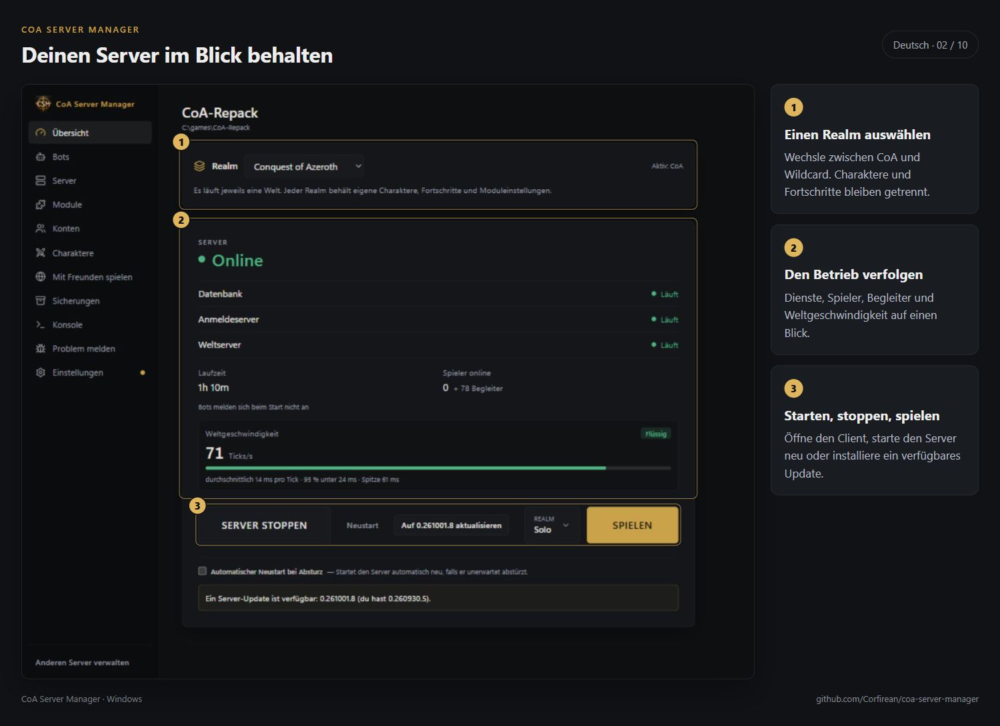
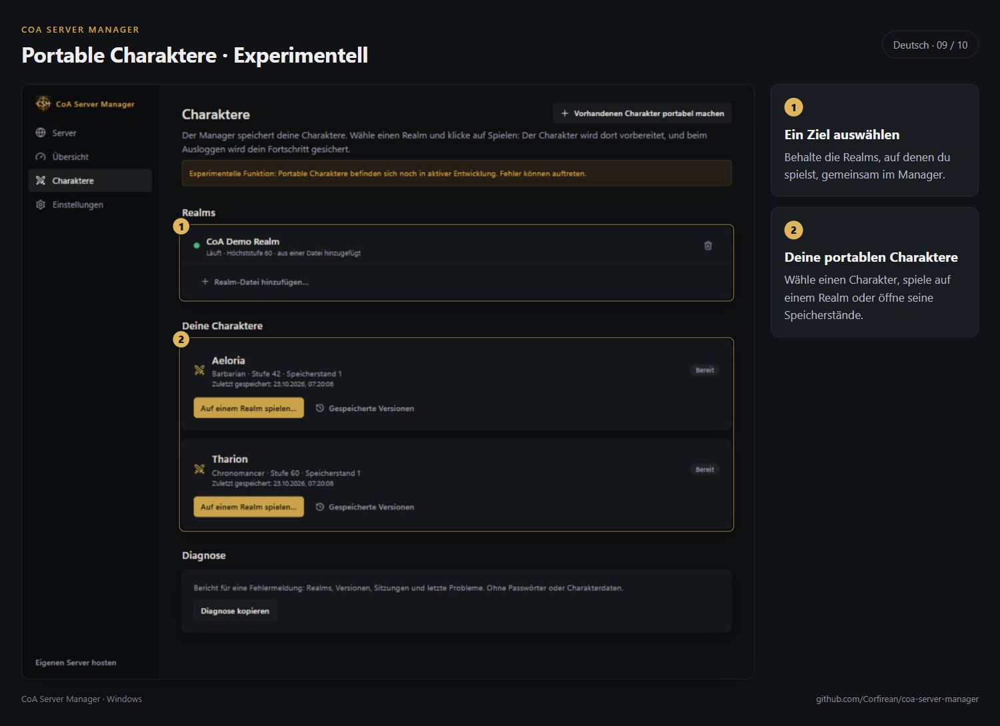
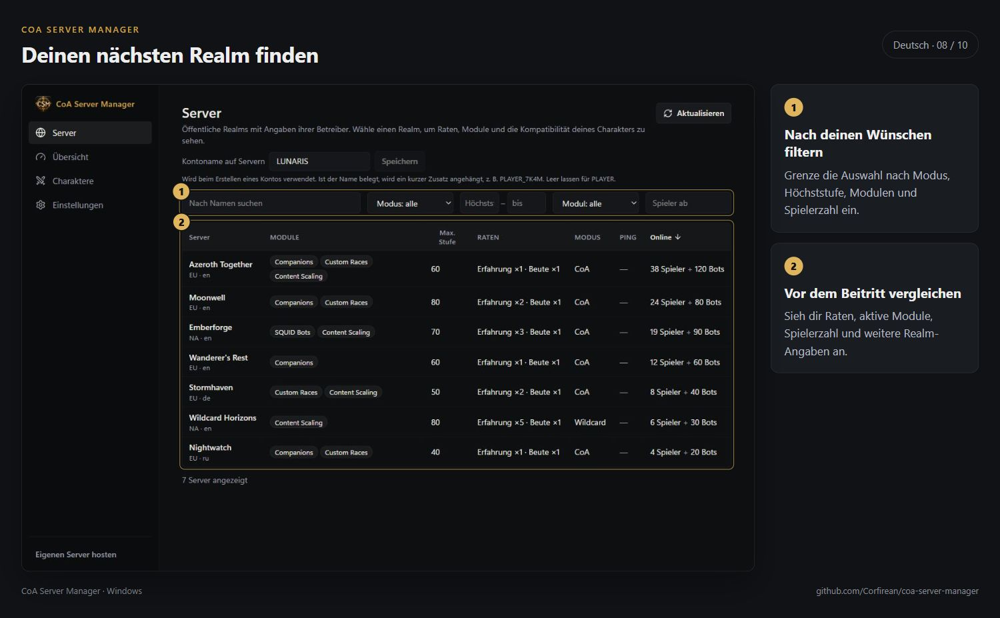
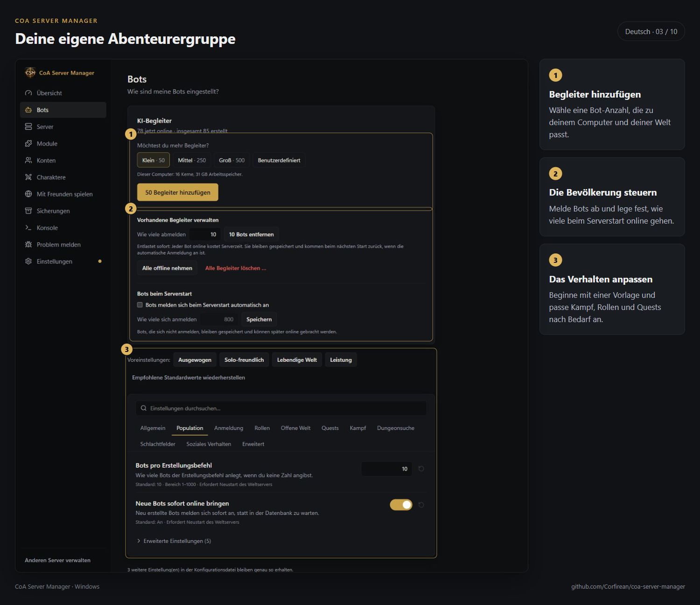
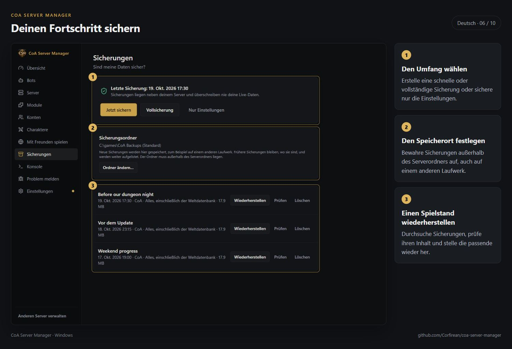

# CoA Server Manager

[English](README.md) · [Русский](README.ru.md) · **Deutsch** · [Français](README.fr.md) · [Español](README.es.md) · [简体中文](README.zh-CN.md)

**Portable Characters sind experimentell.** Die Funktion wird noch entwickelt und kann Fehler enthalten.

Eine Windows-Anwendung, mit der du deinen eigenen **Conquest of Azeroth**-Server auf Basis von AzerothCore mit wenigen Schritten einrichtest und betreibst. Konsole, manuelle Konfigurationsdateien und separate Datenbankprogramme sind dafür nicht nötig. Entwickelt mit Tauri 2, Rust und React.



## Funktionen

- **Portable Characters — experimentell.** Bewahre Charaktere samt gespeicherten Versionen im Manager auf und übernimm vorhandene Charaktere von Realms, auf die du Zugriff hast. [Zur Anleitung](docs/de/PORTABLE-CHARACTERS.md).
- **Realms entdecken.** Vergleiche öffentlich gelistete Realms nach Spielmodus, Höchststufe, Raten, Modulen und Spielerzahl.
- **Einfache Einrichtung.** Der Manager lädt ein signiertes Serverpaket herunter, prüft die Dateien, richtet die Datenbank ein und erstellt dein erstes Konto. Downloads lassen sich fortsetzen; vorhandene Server kannst du ebenfalls einbinden.
- **Starten, stoppen, spielen.** Steuere Datenbank, Auth- und Weltserver gemeinsam. Status, Laufzeit und Spielerzahl siehst du direkt. Beim Spielstart wird die passende Realmlist verwendet.
- **Spielclient verwalten.** Verwende deinen vorhandenen Client oder lade ihn über den Manager herunter: etwa 43 GB, fortsetzbar und dateiweise geprüft. Verwaltete Clients erhalten Update-Hinweise; selbst veränderte Dateien werden nur mit deiner Zustimmung ersetzt.
- **Serverupdates.** Der Manager sucht beim Start und alle fünf Minuten nach Updates. Ed25519-Signaturen schützen die Pakete. Vor dem Update wird eine Sicherung erstellt; eigene Änderungen bleiben erhalten und ein Rollback ist möglich.
- **Sicherungen.** Sichere Charaktere, Konten und Einstellungen bei Bedarf oder automatisch vor Updates. Prüfen und Wiederherstellen geht direkt in der Anwendung.
- **CoA, Wildcard und Warcraft Reborn.** Wähle den Realm unter Übersicht. Die Serverversion muss den gewählten Modus unterstützen. Beim ersten Wechsel entstehen eine eigene Welt und eine leere Charakterdatenbank. Konten werden geteilt, Charaktere und Moduleinstellungen bleiben getrennt. Ein laufender Server speichert die Charaktere und startet beim Wechsel neu. Schließe vorher den Client; bei geöffnetem Client wird die Realm-Auswahl erst beim nächsten Start über den Manager übernommen. Bots sind auf Wildcard und Warcraft Reborn nicht verfügbar; andere Zusatzmodule sind dort experimentell. Sicherungen und Datenbankupdates berücksichtigen alle angelegten Realms. CoA und Wildcard können gemeinsam laufen. [Wildcard](docs/de/WILDCARD.md) · [Warcraft Reborn](docs/de/WARCRAFT-REBORN.md).
- **Begleiter-Bots.** Erstelle Bots mit passender Stufe, verfolge den Fortschritt, pausiere die Erstellung oder melde Bots ab. Entferne bei Bedarf eine bestimmte Anzahl, um den Server zu entlasten, und lege die Zahl beim Serverstart fest.
- **Realmlists wechseln.** Speichere benannte Verbindungen wie Solo oder PTR und wähle sie neben der Spiel-Schaltfläche. Die zuvor verwendete Datei wird gesichert.
- **Konten und Einstellungen.** Verwalte Namen, Passwörter und Zugriffsrechte. Für Server und Bots gibt es verständliche Optionen und Voreinstellungen, außerdem eine Serverkonsole und eine Spielerliste mit Kontoverwaltung.
- **Module.** Aktiviere Zusatzfunktionen, öffne ihre Einstellungen oder die GitHub-Seite des jeweiligen Projekts.
- **Mit Freunden spielen.** Erreichbarkeit prüfen, Firewall und UPnP einrichten und Verbindungen über LAN, direkte Adressen oder private Netze/Tailscale vorbereiten. Anleitungen und ein Paket mit Verbindungsdaten helfen deinen Freunden beim Beitritt.
- **Probleme melden.** Bereite einen GitHub-Fehlerbericht mit automatisch eingetragenen Versionsangaben vor.
- **Managerupdates.** Sie werden im Hintergrund geladen und beim Schließen installiert. Deine Server werden dabei weder angehalten noch verändert.
- **Sprachen:** Englisch, Russisch, Deutsch, Französisch, Spanisch und vereinfachtes Chinesisch.

## Screenshots und Anleitungen

| Portable Characters — experimentell | Öffentliche Realms |
|---|---|
|  |  |

| Begleiter | Sicherungen |
|---|---|
|  |  |

[Zur Galerie](docs/de/SCREENSHOTS.md) · [Alle Anleitungen](docs/de/README.md). Die Galerie zeigt auch Einrichtung, Module, Spielclient, Verbindungen mit Freunden und die Übernahme eines vorhandenen Charakters.

## Installation

Lade das Installationsprogramm von der [Release-Seite](https://github.com/Corfirean/coa-server-manager/releases/latest) herunter und starte es. Für den Server brauchst du etwa 10 GB freien Speicher. Der Spielclient benötigt zusätzlich etwa 43 GB: Wähle einen vorhandenen Client oder lade ihn über den Manager.

## Änderungen

[Manager-Changelog](CHANGELOG.md) · [Server-Changelog](https://github.com/Corfirean/coa-server-build/blob/main/CHANGELOG.md). Manager und Server haben getrennte Versionsverläufe. Ein Managerupdate aktualisiert nicht den Server.

## Projektstatus

**In aktiver Entwicklung.** Fehler sind weiterhin möglich. Wenn du ein Problem findest, [erstelle bitte ein Issue](https://github.com/Corfirean/coa-server-manager/issues/new/choose).

### Bekannte Einschränkungen

- Der Ascension-Client 3.3.5 nimmt keine Zugangsdaten über die Kommandozeile an. Gib dein Passwort selbst ein oder verknüpfe ein bestehendes Konto.
- Windows schützt vertrauliche Daten mit DPAPI (`CryptProtectData`) und zusätzlicher Entropie zur Domänentrennung. Linux/macOS verwenden Dateien mit den Zugriffsrechten `0600`.
- Eine bestehende direkte TCP-Verbindung lässt sich nicht während der Sitzung auf einen Relay umstellen. Nach einem Verbindungsabbruch wird beim nächsten Beitritt automatisch auf die Ausweichroute zurückgegriffen.
- Für sichere entfernte Importe portabler Charaktere muss `CharacterDatabase.WorkerThreads = 1` bleiben; das ist der Standardwert.

## Entwicklung

```sh
npm install
cargo test --workspace
npx tsc --noEmit
node tools/check-i18n.mjs
npx vite
cargo build -p coa-server-manager
```

Die Befehle installieren Abhängigkeiten, führen Tests aus, prüfen Typen und Übersetzungen, starten die Browseransicht mit Testdaten und bauen die native Anwendung. Der Debug-Build verwendet `http://localhost:1420`.

Die Programmlogik liegt in `crates/coa-core`, Paket- und Signaturwerkzeuge in `crates/coa-release`, native Befehle in `src-tauri` und die Oberfläche in `src`.

`cargo run -p coa-core --example scan -- <folder>` prüft eine vorhandene Installation nur lesend. Verwende für Start-/Stopp-Tests ausschließlich eine entbehrliche Testkopie: `tools/make-fixture.ps1` erstellt `C:\games\coa-fixture` aus der unveränderten Paketdatenbank mit anderen Ports. Teste niemals an einem genutzten Server. `tests/e2e/cdp.mjs` steuert das echte Fenster über WebView2 mit `WEBVIEW2_ADDITIONAL_BROWSER_ARGUMENTS=--remote-debugging-port=9222`.

## Lizenz

Der Manager ist freie Software unter der [GNU AGPL v3.0](LICENSE), Kennung `AGPL-3.0-only`.

- Der installierte Server basiert auf einem öffentlichen [AzerothCore-Fork](https://github.com/Corfirean/azerothcore-wotlk-coa). Für von MaNGOS übernommene Teile gilt GPL-2.0-or-later, für eigene AzerothCore-Teile AGPL-3.0. [mod-coa-playerbots](https://github.com/Corfirean/mod-coa-playerbots) steht unter AGPL-3.0. Die exakten Quellstände stehen im Paketmanifest, damit der passende Quellcode auffindbar bleibt.
- Das mitgelieferte MySQL behält seine GPL-2.0-Lizenz; der Lizenztext liegt im Paket unter `Licenses`.
- Die Spieldaten in `Data` (`dbc`, `maps`, `vmaps`, `mmaps`) stammen aus dem Client des eingestellten Ascension-Realms Conquest of Azeroth. Sie fallen **nicht** unter die Lizenz des Managers.
