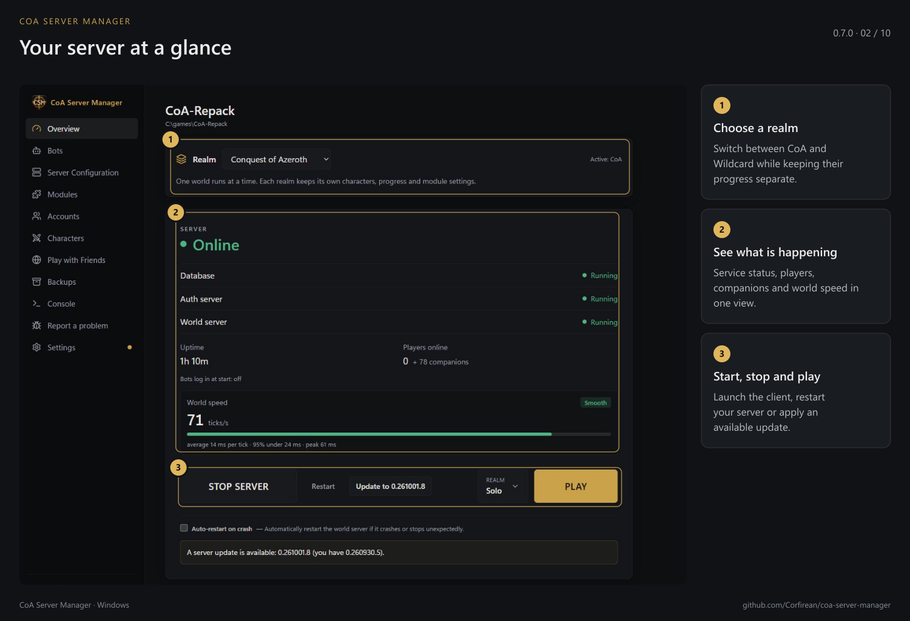
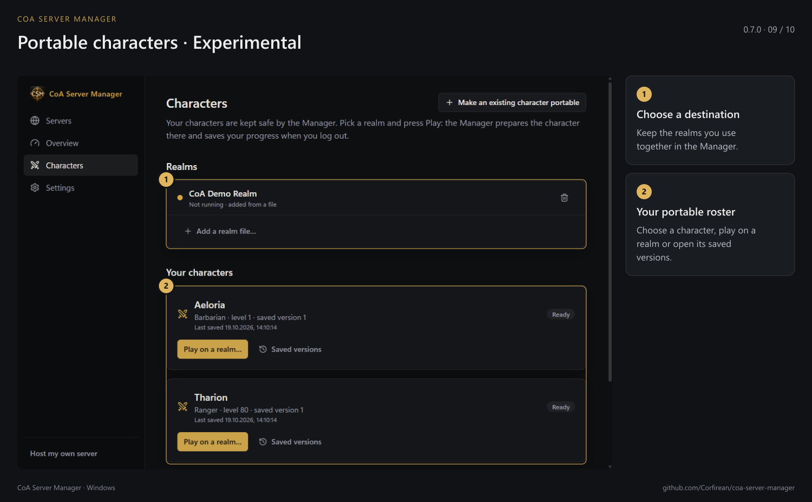
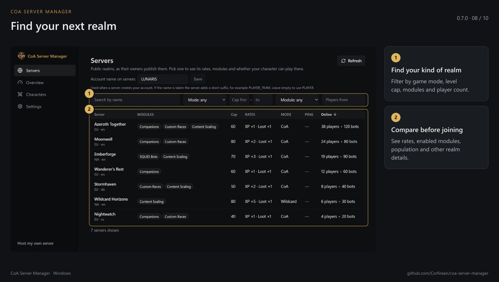
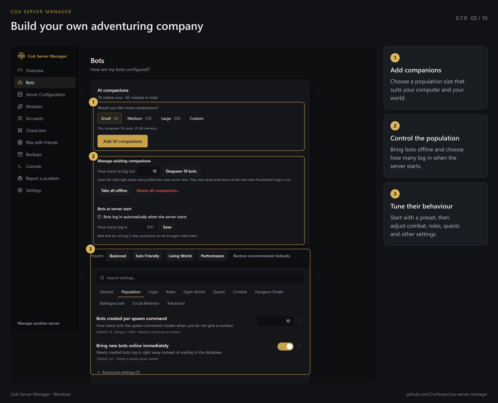
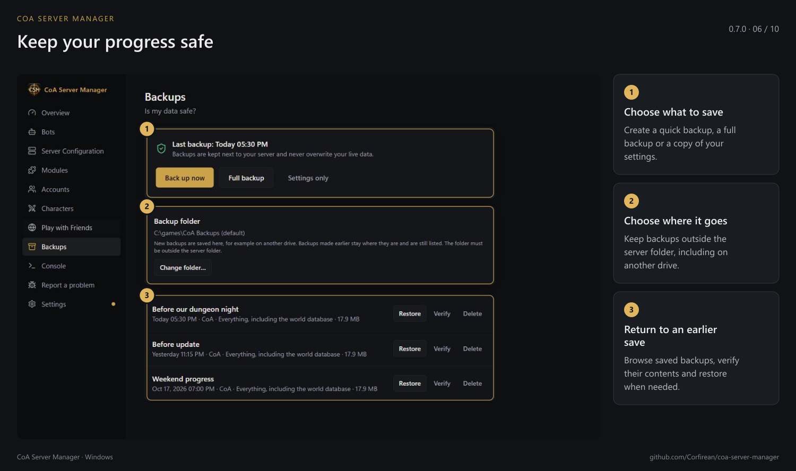

# CoA Server Manager

[English](README.md) · **Русский** · [Deutsch](README.de.md) · [Français](README.fr.md) · [Español](README.es.md) · [简体中文](README.zh-CN.md)

**Переносимые персонажи — экспериментальная функция.** Она ещё развивается и может работать с ошибками.

Приложение для Windows, с которым можно установить и запустить свой сервер **Conquest of Azeroth** на базе AzerothCore за несколько шагов. Управляйте сервером через интерфейс, без консоли, ручного редактирования конфигов и отдельных программ для базы данных. Менеджер написан на Tauri 2, Rust и React.



## Возможности

- **Переносимые персонажи — экспериментально.** Храните персонажей и историю сохранений в менеджере, делайте переносимыми уже существующих персонажей с доступных вам реалмов. [Как это работает](docs/ru/PORTABLE-CHARACTERS.md).
- **Каталог реалмов.** Сравнивайте публичные серверы по режиму игры, максимальному уровню, рейтам, модулям и числу игроков.
- **Простая установка.** Менеджер скачивает подписанный пакет сервера, проверяет файлы, настраивает базу данных и создаёт первый аккаунт. Прерванную загрузку можно продолжить. Можно также подключить уже установленный сервер.
- **Запуск, остановка и игра.** Управляйте базой данных и обоими серверными процессами одной кнопкой. На главном экране видны состояние, время работы и игроки онлайн. Кнопка запуска игры выбирает нужный realmlist.
- **Игровой клиент.** Подключите свой клиент или скачайте его через менеджер — около 43 ГБ, с продолжением загрузки и проверкой файлов. Для управляемого клиента доступны обновления; ваши изменения заменяются только с вашего согласия.
- **Обновления сервера.** Проверка выполняется при запуске и каждые пять минут. Пакеты защищены подписью Ed25519; перед установкой создаётся резервная копия. Пользовательские изменения сохраняются, предусмотрен откат.
- **Резервные копии.** Сохраняйте персонажей, аккаунты и настройки вручную или автоматически перед обновлениями. Проверка и восстановление доступны в приложении.
- **CoA, Wildcard и Warcraft Reborn.** Выбирайте реалм в разделе «Обзор». Нужна серверная сборка с поддержкой выбранного режима. При первом переключении создаются отдельный мир и пустая база персонажей. Аккаунты общие, персонажи и настройки модулей раздельные. Переключение работающего сервера сохраняет персонажей и перезапускает его. Закройте клиент перед переключением; если он открыт, новый реалм будет выбран при следующем запуске через менеджер. Боты недоступны в Wildcard и Warcraft Reborn, остальные дополнительные модули там экспериментальны. Копии и обновления охватывают все созданные реалмы. Одновременно можно запускать CoA и Wildcard. [Гайд по Wildcard](docs/ru/WILDCARD.md) · [Warcraft Reborn](docs/ru/WARCRAFT-REBORN.md).
- **Компаньоны-боты.** Заселяйте мир ботами подходящего уровня, следите за созданием, приостанавливайте его, отключайте ботов или удаляйте нужное количество для снижения нагрузки. Можно задать число ботов при старте сервера.
- **Список подключений.** Сохраняйте несколько realmlist с понятными названиями, например Solo и PTR, и переключайте их рядом с кнопкой игры. Предыдущий файл сохраняется.
- **Аккаунты и настройки.** Управляйте именами, паролями и уровнями доступа. Настраивайте сервер и ботов через понятные параметры и готовые наборы; доступны консоль сервера и список игроков.
- **Модули.** Включайте дополнительные возможности, меняйте их настройки и переходите в репозитории авторов с одной страницы.
- **Игра с друзьями.** Проверка доступности, настройка брандмауэра и UPnP, подключение по локальной сети, напрямую или через частную сеть/Tailscale. Внутри есть пошаговые инструкции и пакет с данными подключения для друзей.
- **Сообщения об ошибках.** Менеджер помогает подготовить issue на GitHub и подставляет версии программ.
- **Обновление менеджера.** Загружается в фоне и устанавливается при закрытии приложения. Ваши серверы при этом не останавливаются и не изменяются.
- **Языки:** английский, русский, немецкий, французский, испанский и упрощённый китайский.

## Скриншоты и гайды

| Переносимые персонажи — экспериментально | Публичные реалмы |
|---|---|
|  |  |

| Компаньоны | Резервные копии |
|---|---|
|  |  |

[Все скриншоты](docs/ru/SCREENSHOTS.md) · [Гайды для игроков и владельцев серверов](docs/ru/README.md). В галерее также показаны установка, модули, клиент, подключение друзей и создание переносимого персонажа.

## Установка

Скачайте установщик со страницы [релизов](https://github.com/Corfirean/coa-server-manager/releases/latest) и запустите его. Для сервера нужно около 10 ГБ свободного места. Клиент устанавливается отдельно и занимает около 43 ГБ: укажите существующую папку или скачайте его через менеджер.

## Что изменилось

[Ченджлог менеджера](CHANGELOG.md) · [Ченджлог сервера](https://github.com/Corfirean/coa-server-build/blob/main/CHANGELOG.md). Это отдельные продукты с отдельной историей версий: обновление менеджера не обновляет сервер.

## Состояние проекта

**Проект активно развивается.** Ошибки ещё возможны. Если встретили проблему, [создайте issue](https://github.com/Corfirean/coa-server-manager/issues/new/choose).

### Известные ограничения

- Клиент Ascension 3.3.5 не принимает логин и пароль через командную строку. Введите пароль вручную или привяжите существующий аккаунт.
- В Windows секреты защищены DPAPI (`CryptProtectData`) с отдельной энтропией домена. На Linux/macOS используются файлы с правами `0600`.
- Уже открытое прямое TCP-соединение нельзя переключить на ретранслятор без разрыва. Резервный маршрут выбирается при следующем подключении.
- Для безопасного удалённого импорта переносимых персонажей оставьте `CharacterDatabase.WorkerThreads = 1` — это значение по умолчанию.

## Разработка

```sh
npm install
cargo test --workspace
npx tsc --noEmit
node tools/check-i18n.mjs
npx vite
cargo build -p coa-server-manager
```

Команды устанавливают зависимости, запускают тесты, проверяют типы и переводы, открывают браузерный интерфейс с тестовыми данными и собирают нативное приложение. В отладочном режиме оно использует `http://localhost:1420`.

`crates/coa-core` содержит основную логику, `crates/coa-release` — упаковку и подписи, `src-tauri` — команды приложения, `src` — интерфейс.

Проверить существующую сборку без изменений можно командой `cargo run -p coa-core --example scan -- <folder>`. Для проверок запуска и остановки используйте только отдельную тестовую копию: `tools/make-fixture.ps1` создаёт `C:\games\coa-fixture` из чистой базы пакета, с другими портами. Не проводите такие проверки на сервере, которым пользуются игроки. `tests/e2e/cdp.mjs` управляет настоящим окном через WebView2 с `WEBVIEW2_ADDITIONAL_BROWSER_ARGUMENTS=--remote-debugging-port=9222`.

## Лицензия

Менеджер — свободное ПО под [GNU AGPL v3.0](LICENSE), идентификатор `AGPL-3.0-only`.

- Устанавливаемый сервер основан на [форке AzerothCore](https://github.com/Corfirean/azerothcore-wotlk-coa): части, унаследованные от MaNGOS, используют GPL-2.0-or-later, собственные части AzerothCore — AGPL-3.0. Модуль [mod-coa-playerbots](https://github.com/Corfirean/mod-coa-playerbots) использует AGPL-3.0. Точные коммиты записываются в манифест пакета, чтобы можно было найти соответствующий исходный код.
- MySQL распространяется по собственной лицензии GPL-2.0; её текст находится в папке `Licenses` пакета.
- Данные игры в `Data` (`dbc`, `maps`, `vmaps`, `mmaps`) извлечены из клиента закрытого реалма Ascension Conquest of Azeroth. Лицензия менеджера на них **не распространяется**.
