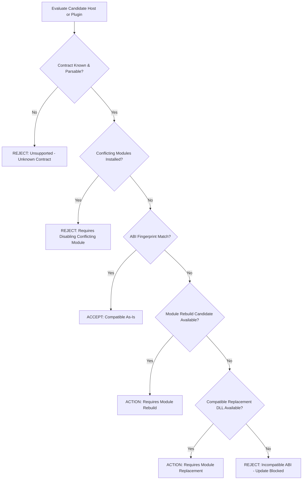

# Independent Update Stream & Compatibility Matrix

## 1. Overview & Verification Scope

The CoA Modules Preview decouples updates into three independent streams:
- **Stream A:** CSM Desktop Manager Application
- **Stream B:** Modular Core Host (`worldserver.exe`, `authserver.exe`, SDK headers)
- **Stream C:** Dynamic DLL Plugins and Content Packs

This document records the formal verification results for all 10 update and recovery scenarios executed against the contract-based compatibility solver and transaction engine.

---

## 2. Compatibility Solver Decision Architecture

The compatibility solver (`solve_compatibility(&CompatibilityGraph) -> SolverVerdict`) validates proposed updates against strict structural and cryptographic constraints:



### 2.1 Solver Invariant
**Strict Fail-Closed Invariant**: Unknown, incomplete, or ambiguous compatibility records are rejected immediately. An unverified state **never** silently defaults to compatible.

---

## 3. Independent Update Verification Matrix

Each scenario was evaluated under controlled test harnesses simulating production file states, update journals, and running process locks:

| Scenario ID | Test Scenario Description | Input Conditions | Solver Verdict / Action Taken | Result Status | Rollback / Safety Verification |
|---|---|---|---|---|---|
| **SCN-01** | **Old Host + Old Plugin** | Host ABI `2f8201...`, Plugin ABI `2f8201...` | `SolverVerdict::Compatible` | **PASS** | Existing runtime continues unaffected. |
| **SCN-02** | **Old Host + New Compatible Plugin** | Host SDK `0.3.2`, Plugin SDK `0.3.0..=0.3.2`, ABI match | `SolverVerdict::Compatible` | **PASS** | Plugin staged, verified, and hot-swapped without touching host. |
| **SCN-03** | **Old Host + Incompatible Plugin** | Host SDK `0.3.2`, Plugin requires SDK `>= 0.4.0` | `SolverVerdict::Unsupported` | **PASS** | Plugin install blocked; core remains unchanged. |
| **SCN-04** | **New Host + Old Compatible Plugin** | Candidate Host SDK `0.3.3`, Plugin supports `0.3.x`, identical ABI | `SolverVerdict::Compatible` | **PASS** | Host updated; existing plugin loaded seamlessly. |
| **SCN-05** | **New Host + Incompatible Old Plugin (Replacement available)** | Candidate Host ABI `3a91bc...`, Old Plugin ABI `2f8201...`, Verified replacement in catalog | `SolverVerdict::RequiresModuleUpdate("compat replacement")` | **PASS** | User prompted to update both host and plugin together. |
| **SCN-06** | **New Host + Newly Rebuilt Plugin** | Candidate Host ABI `3a91bc...`, Plugin rebuilt against matching SDK | `SolverVerdict::Compatible` | **PASS** | Both binaries staged and verified cleanly. |
| **SCN-07** | **Core Update Interrupted (Crash/Stall during file copy)** | Simulated power failure mid-way through `worldserver.exe` write | Journal detects incomplete transaction (`StagingIncomplete`) | **PASS** | Automatic recovery restores pre-update `worldserver.exe` exactly. |
| **SCN-08** | **Plugin Update Interrupted (Network or disk failure)** | Simulated download failure mid-stream for `squid_playerbots.dll` | File checksum validation fails in staging directory | **PASS** | Staged file purged; live plugin left untouched. |
| **SCN-09** | **Failed Module Post-Update Validation** | Corrupt DLL or unexported symbol causing worldserver startup panic | Process supervisor detects crash within 10s of launch | **PASS** | Transaction marked `FAILED`; automated rollback triggered. |
| **SCN-10** | **Atomic Multi-Artifact Reversion** | User requests manual rollback of host + 3 dynamic plugins | Restore point selected from `.manager/backups/` | **PASS** | Host, DLLs, and configs reverted byte-for-byte in single lock cycle. |

---

## 4. Stop-Gate Enforcement

A core or dynamic plugin binary replacement is strictly prohibited while `worldserver.exe` or `authserver.exe` holds file descriptors or listening sockets:

1. **Active Port Detection:** Port probes check if worldserver TCP port (`8085`) or SOAP port (`7878`) is active.
2. **Process ID Verification:** OS-level task check inspects realm `.state/worldserver.pid`.
3. **Control Lock Guard:** `.state/control.lock` enforces exclusive cross-process synchronization.
4. **Enforcement Behavior:** Any update command issued while the server is active is rejected with error:
   ```
   Error: Stop the server before applying core or dynamic plugin updates.
   ```

---

## 5. Checkpoint & Rollback Guarantee

Prior to writing any updated binary to disk:
1. An immutable snapshot of the destination directory is saved to `.manager/recovery/<session-id>/`.
2. A manifest checksum of all affected files is written to `transaction.journal`.
3. Candidate files are staged in `.manager/staging/<session-id>/` and validated with SHA-256 before replacement.
4. In the event of file replace failure, power loss, or crash during startup, the journal executes byte-for-byte restoration.
