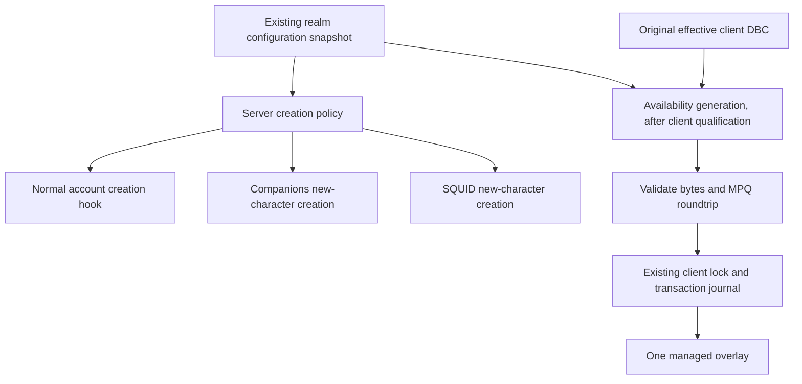

# Per-race toggles: internal design and implementation status

This is an internal specification and work-in-progress record, not a released user guide.
Current verdict: **PARTIAL**. Client hiding and disabled rows were confirmed by the owner;
server policy, new-bot integration and Manager controls are now implemented in feature branches.
Native build qualification and server gameplay acceptance are still pending.

See [audit](../PER_RACE_TOGGLES_AUDIT.md) and [verification record](PER_RACE_TOGGLES_TESTS.md).

## Verified data and outstanding client decision

The local manifest identifies CoA Custom 1.9.2. The candidate source archive is `patch-ZZZF.MPQ`.
Its ChrRaces has WDBC layout 95/69/276/2428 (records/fields/record bytes/string bytes).
Its DBC SHA-256 is `b78635b08bf0bd63d2898fce97c1fb162c8a9c41632703172eefa88bae79061f`.
Observed IDs include Sethrak 82, Gnoll 83 and Saberon 97, all initially Flags 12.

The experiment sets `originalFlags | 0x01` only for selected IDs. Empty selection preserves
every original byte. Each run reads the explicitly selected source MPQ anew; it never consumes
the previous generated DBC. Re-enabling must restore the original record, including an original
NOT_PLAYABLE bit if present; it must not make an originally nonplayable race playable.

These observations do not qualify a client version. Actual archive precedence, menu behavior,
other-race creation and existing-character login are untested. No managed overlay filename has
been chosen. The tool does not infer precedence from filename sorting.

## Intended integration

The new server key is `CoACustomRaces.DisabledRaceIds` in the existing module config.
It requires a newly built server; no installed server binary has been replaced. Empty or missing
key retains the previous master-switch behavior.
Validate the entire set before applying it; reject malformed, unknown and stock IDs without a
partial policy. Validate identity against effective server/client data, not numeric ranges alone.

Creation policy is independent of login and import. It must not modify existing characters,
appearance, items, spells, progress or Portable Characters identity. Bot creation additionally
obeys master switches, module switches, user exclusions and crashing-race restrictions. Existing
bot admission must not inherit a new-character restriction accidentally.

Use current module configuration, additive `.dist` merge and `Settings/realm-profiles/` snapshots.
Do not introduce another authoritative policy store. The future client record is provenance and
ownership metadata, not a replacement for the realm configuration.

Local PLAY must reconcile the selected profile before launch while the client is closed, using
the same `.coa-races.lock` as package operations. Shared clients have one currently installed
overlay; remote policies cannot be guessed. Unknown formats or conflicting ownership must fail
with a truthful status. Client and server application status must be separate in the UI.

Client repair/update must invalidate the previous overlay when the original effective DBC
changes and regenerate from the new original only after compatibility checks. Empty restrictions
must remove only the verified CSM-owned overlay. Actual install/recovery/update behavior is
not implemented by the offline tool.

## Offline tool

`tools/race_availability_poc.py` extracts with an explicitly supplied, existing Unicode StormLib
DLL. That DLL is a laboratory dependency only; no Manager/user dependency has been selected.
The tool writes `original.dbc`, `generated.dbc`, `experiment.MPQ` and `report.json` to a new output
directory after successful verification. It never installs an overlay, edits an input MPQ or
launches a process. The archive contains one game payload plus StormLib's internal listfile.

The fingerprint includes original DBC hash, sorted unique disabled IDs, algorithm version and
recorded client profile. It supports reproducibility checks; runtime caching is not implemented.
An empty selection still produces an offline test artifact so byte equality can be checked;
production empty-set removal is a separate, unimplemented requirement.

No game files or DLLs are checked into Git. Tests generate synthetic DBC/MPQ fixtures locally.
No export/distribution feature, release-channel change or publication is included.

## Remaining acceptance gate

The owner subsequently confirmed the Lua visibility and disabled-row probes through screenshots.
The selected client approach reuses the existing GlueXML filter rather than changing DBC flags.
This does not establish whether the earlier DBC-bit hypothesis works.

The owner deferred database/server testing while another server runs bot tests.
Do not launch the game, servers or MySQL or capture/control the screen without renewed authorization.
Use the owner-confirmed GlueXML approach for the next client integration stage. It preserves
the original DBC. The DBC-bit approach has not been declared incompatible; it was not live-tested.

## Server controls implemented in the feature branches

### Maintenance when new races are added

Whenever upstream adds races, include every new playable custom RaceID in the availability
list and verify its name and Horde/Alliance grouping. The Manager reads this list from the
installed server catalog automatically; update the server catalog rather than maintaining a
second hardcoded UI list. Review and explicitly save existing restrictions after the catalog
changes, preserving the owner's choices for unchanged IDs.

Also update and verify the client Lua RaceID mapping and filtering for the new races. A race
appearing in the Manager does not by itself establish client support. Check creation restrictions
and new-bot generation in both CoA Companions and SQUID, retaining user and crashing-race exclusions.

### Current implementation

Manager exposes a versioned catalog read from the server's `DataDir/dbc_races/ChrRaces.dbc`, with
strict WDBC layout/ID/name validation and stock/nonplayable rows excluded. The UI supports search,
counts, per-race allow checkboxes, Allow all, explicit Save/Discard and navigation guards. New
strings exist in all six Manager languages.

Saving requires a stopped server, no unfinished update, the existing control lock, an unchanged
catalog SHA-256 and the same selected realm as the loaded draft.
It uses the normal module backup/config writer. Servers whose distributed configuration does
not declare the new key cannot be configured through this control. The executable is also checked
for the key, following existing realm capability detection. The UI reports saved settings
and restart requirements, not a verified running-server Applied status. Template detection does
not independently attest the identity of a manually modified server executable.

Saved restrictions include the source catalog SHA-256. A changed catalog or orphaned IDs requires
explicit review and save; simply opening the panel does not migrate settings. Core and the offline
bot factory reject a mismatched bound catalog before creating characters. Empty hashes remain
supported for manually authored legacy configurations.

The core module stages a whole policy, validates configured IDs against loaded server race data,
and applies it atomically on startup/reload. Invalid input retains the previous policy; on an
initial invalid configuration, new custom creation remains disabled. Stock creation remains
available. The normal account hook remains in place and import/login paths are unchanged.

CoA Companions' common clone entry calls the account creation hook before inserting a new bot;
its selection also preserves explicit crashing exclusions. SQUID's random factory calls the
same hook while constructing candidate races, without adding owner restrictions to existing-bot
admission lists. The offline Companions factory reads configuration and filters prohibited
templates before creating accounts or generating insert SQL. No SQL was executed for verification.

The old Manager synchronization now preserves explicit user race exclusions. It only replaces
lists carrying its old ownership comment with an exact known generated value. Crashing-race
settings are never rewritten. BotsEnable is read directly from the Custom Races configuration
when available rather than inferred from unrelated exclusion choices.

Automatic production client synchronization and client update invalidation remain unimplemented.
Server-side catalog binding is implemented. The fixed three-race test overlay is not automatically changed
by these new server controls. This limitation is explicitly visible in the Manager UI.
