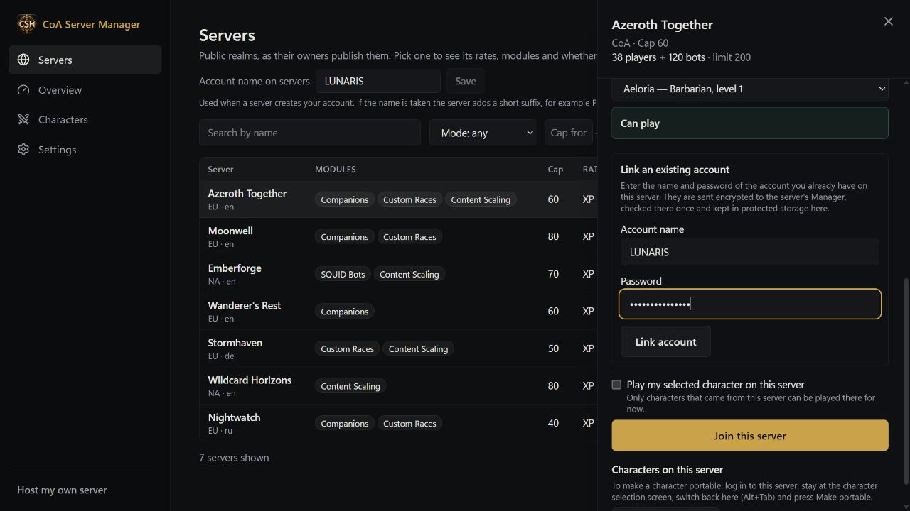
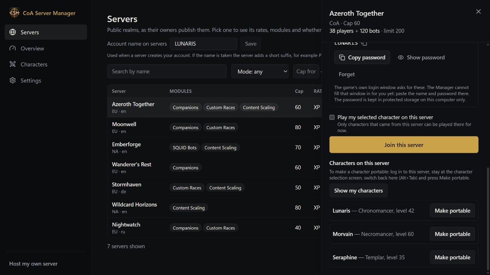
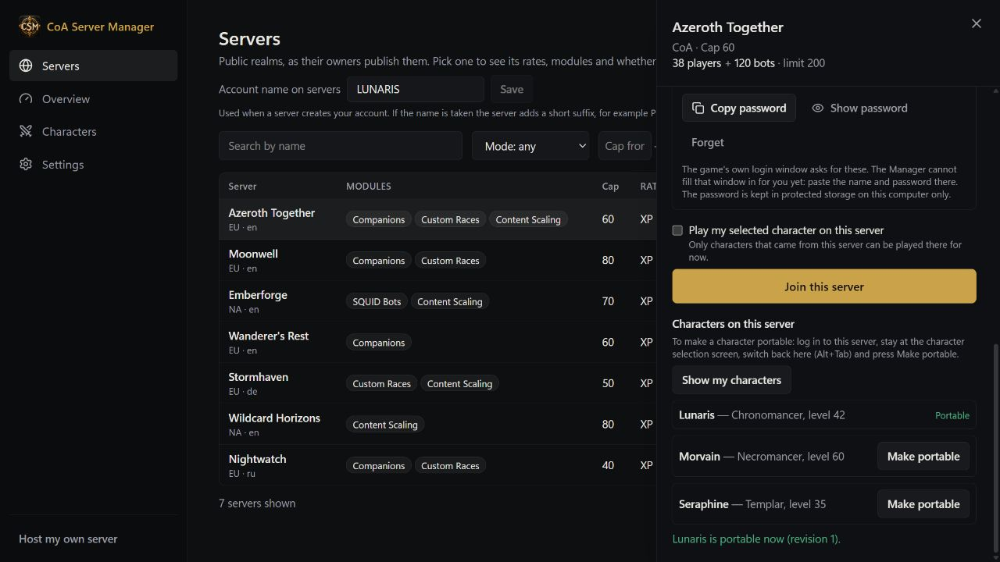

# Take your character with you

**English** · [Русский](ru/PORTABLE-CHARACTERS.md) · [Deutsch](de/PORTABLE-CHARACTERS.md) · [Français](fr/PORTABLE-CHARACTERS.md) · [Español](es/PORTABLE-CHARACTERS.md) · [简体中文](zh-CN/PORTABLE-CHARACTERS.md)

**Portable characters are experimental.** The feature is in active development and may contain bugs.

Portable characters let you keep a saved character in the Manager and play it on compatible realms (Conquest of Azeroth and Wildcard).

## Multi-Ruleset Isolation Invariant

Portable characters are strictly isolated by gameplay ruleset (`coa`, `wildcard`, `reborn`):
- A character created or claimed on a **Conquest of Azeroth** realm is a CoA character and can only ever be played on CoA realms.
- A character created or claimed on a **Wildcard** realm is a Wildcard character and can only ever be played on Wildcard realms.
- A character created or claimed on a **Warcraft Reborn** realm can only ever be played on Reborn realms.

Cross-ruleset transfers, imports, joins, sessions, and collection merges are impossible: the Manager strictly rejects any mismatched request at every protocol, session, and database boundary with zero mutation to your characters or servers.

## Make your first character portable

1. Log out of the character in the game. Keep the Manager open.
2. Open **Characters** and choose **Make an existing character portable**.
3. Select a realm you can access and choose your character.
4. Choose **Make portable**. Your character appears under **Your characters**.

If a character cannot be selected, read the reason beside it. Bot characters, active challenges and some pending rewards can block the operation. Creating the portable copy does not delete the original realm character.

## Make a character from another realm portable

1. Open **Servers** and select the realm where your character lives.
2. Choose **Link an existing account** and enter the account you already use on that realm.
3. Log in to that realm in the game and stay at the character selection screen.
4. Switch back to the Manager with **Alt+Tab** and choose **Show my characters**.
5. Find your character and choose **Make portable**.
6. Wait for the confirmation and the **Portable** badge.

## Play your portable character

1. Find a compatible server under **Servers** in player mode, or **Play with Friends** when hosting. You can also use a realm already available to your Manager.
2. Choose your portable character and review compatibility before pressing **Play**.
3. Follow the account prompt. Some hosts create an account for you; others require an existing account.
4. Launch the game when the Manager says the character is ready.
5. Keep the Manager open while playing. Log out and wait for progress to finish saving before closing it or moving to another realm.

A realm with a lower level cap may play your character at a lower level. Check the warning: unsupported content is held back rather than silently discarded. Portable play requires a compatible server; installing the Manager alone does not add support to every server.

## Saved versions and conflicts

Use **Saved versions** to see when progress was saved. If the Manager reports a conflict, follow its explanation before continuing. Avoid playing two copies at once, and keep normal server backups as well.

[All guides](README.md)

## Portable access and relay

In the realm's Public list card, enable “Allow portable characters on this realm” and save. It is off until the owner opts in. Turning it off blocks new exports and imports; it does not delete saved characters. Keep the host Manager running. The control connection and game relay have separate status indicators: a connected control channel does not establish a game tunnel. Characters stay within their original ruleset (CoA, Wildcard or Warcraft Reborn); changing servers does not convert their ruleset.

Keep both Managers running. Saving resumes after reconnecting or restarting, and later logins stay monitored. Wait for saving before switching realms. Your installed servers use local preparation and recovery. Experimental limitation: an older existing copy on another host cannot yet be refreshed automatically while its worldserver runs. Returning may require host maintenance. The stale copy is blocked and your canonical character stays saved. Do not delete the character or reinstall the server to bypass this message.

Stop the server before enabling this for the first time. Saving prepares portable sessions for its next start; disabling access leaves ongoing sessions intact.
