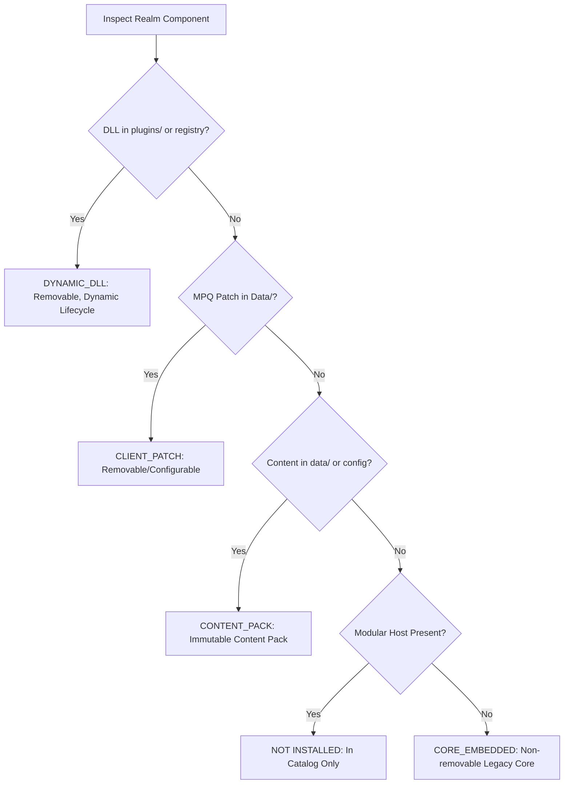

# CoA Modules Preview — Distribution & Architecture Specification

## 1. Executive Summary

The **CoA Modules Preview** platform establishes an isolated, independently updateable, and migration-capable testing system for AzerothCore dynamic module hosting. It provides external testers with an environment to test dynamic C++ DLL plugins, migration of legacy servers, and modular server operations without disrupting production Stable users or databases.

---

## 2. Source & Branch Topology

To prevent regressions and avoid polluting stable production lines, the architecture defines three isolated branches:

| Subsystem | Repository | Production Stable Branch | Preview Isolation Branch | Responsibility |
|-----------|------------|-------------------------|--------------------------|----------------|
| **Manager UI & Engine** | `Corfirean/coa-server-manager` | `main` | `preview/modules-v2` | Desktop UI, updater client, dynamic component inventory, compatibility solver, server migration wizard |
| **Modular Core** | `Corfirean/azerothcore-wotlk-coa` | `master` | `preview/dynamic-plugin-host` | Dynamic plugin loader host, dynamic export contract (`coa_plugin_exports.def`), C++ SDK export header tree |
| **Builder & Distribution** | `Corfirean/coa-server-build` | `main` | `preview/modules-v2` | CI/CD pipelines, candidate lock manifests, qualified packaging, update manifest endpoints |

### 2.1 Branch Isolation Invariants
1. **Zero Stable Impact**: No changes to `main`/`master` workflows or stable release assets (`coa-bots`, stable `latest.json`).
2. **Explicit Preview Pinning**: The Preview build pipeline explicitly consumes `preview/dynamic-plugin-host` and never silently falls back to stable branches.
3. **Immutable Candidate Lock**: Every preview build is anchored by `candidate-lock.json` freezing exact commit SHAs, ABI fingerprints, and verified module hashes.

---

## 3. Authoritative Per-Realm Component Inventory

Prior versions treated `.conf` or `.conf.dist` presence in `etc/modules` as proof of installation, resulting in phantom modules being displayed. The Preview architecture implements an authoritative per-realm classification engine:

### 3.1 Component Classification Matrix



| ComponentType | Description | Detection Rule | Removal Allowed |
|---------------|-------------|----------------|-----------------|
| `DYNAMIC_DLL` | Dynamic C++ library loaded at runtime | Verified `.dll` present in `plugins/` or `.manager/plugins/` + valid registration in `.manager/plugins.json` | **YES** (`can_remove = true`) |
| `CORE_EMBEDDED`| C++ module statically compiled into legacy `worldserver.exe` | Non-modular host + binary commit signature or compiled script registration | **NO** (`can_remove = false`) |
| `CONTENT_PACK`| Server-side game content data | DBC/Maps/VMaps/Data directories present under `data/` | **NO** |
| `CLIENT_PATCH`| Client-side MPQ archive | `patch-Z.mpq` / `patch-4.mpq` present in client directory | **YES** |
| `LOGICAL_FEATURE`| Protocol or core logical behavioral switch | Core configuration toggle (e.g. `client-compat`) | **NO** |

### 3.2 Dynamic Removal & Uninstallation
- All `DYNAMIC_DLL` modules (both official and third-party) can be uninstalled through the UI.
- When uninstalled:
  1. The module entry is removed from `.manager/plugins.json`.
  2. The dynamic `.dll` is purged or archived.
  3. The module disappears from the **Installed** view immediately.
  4. The module remains available in the **Catalog** tab for re-installation.
- Legacy `CORE_EMBEDDED` modules display a non-removable shield badge preventing improper removal actions.

---

## 4. Three Independent Update Streams

The preview platform decouples updates into three independently deliverable channels:

```
                    ┌─────────────────────────────────────────┐
                    │           CoA Update Ecosystem          │
                    └────────────────────┬────────────────────┘
                                         │
         ┌───────────────────────────────┼───────────────────────────────┐
         ▼                               ▼                               ▼
┌──────────────────┐           ┌──────────────────┐           ┌──────────────────┐
│     Stream A     │           │     Stream B     │           │     Stream C     │
│   CSM Preview    │           │   Modular Host   │           │ Dynamic Modules  │
│   Application    │           │  (worldserver)   │           │  & Content Packs │
└────────┬─────────┘           └────────┬─────────┘           └────────┬─────────┘
         │                              │                              │
         ▼                              ▼                              ▼
  Dedicated Preview              Candidate Lock                Independent Module
 Updater Manifest URL           Contract Solver &              Lifecycle & Hot-Swap
(csm-preview-latest.json)          Stop-Gate                     Compatibility Gate
```

### 4.1 Stream A: CSM Modules Preview Application
- **App Identifier:** `com.corfirean.csm.preview` (isolated from stable `com.corfirean.csm`).
- **App Data Scope:** `%APPDATA%\CoA Server Manager Preview`.
- **Updater Endpoint:** `https://raw.githubusercontent.com/Corfirean/coa-server-build/preview/modules-v2/updates/csm-preview-latest.json`.
- **Updater Mode:** Tauri v2 signed updater (`createUpdaterArtifacts: true`).
- **Signature Verification:** Mandatory Ed25519 minisign verification before any binary staging.

### 4.2 Stream B: Modular AzerothCore Host
- Updates the host `worldserver.exe`, `authserver.exe`, and export contract SDK.
- **Stop-Gate Requirement:** Core updates are strictly blocked if `worldserver.exe` is actively running.
- **Rollback Guarantee:** Full transactional pre-update snapshot taken prior to executable swap; corrupt startups trigger automatic binary restoration.

### 4.3 Stream C: Dynamic Modules & SDK-Dependent Plugins
- Modules update on individual release cadences (upstream bugfixes, new features).
- Does NOT force a core host update unless the module requires newer host ABI export capabilities.

---

## 5. Contract-Based Compatibility Resolver

Compatibility is evaluated via the `solve_compatibility(&CompatibilityGraph)` solver engine:

### 5.1 Verification Logic
1. **ABI Fingerprint Check:** Compares host `abi_fingerprint` against plugin `target_abi_fingerprint`.
2. **SDK Range Check:** Evaluates whether `host.sdk_version` satisfies `plugin.min_sdk_version..=max_sdk_version`.
3. **Mutual Exclusivity:** Enforces bot exclusivity (e.g., `companions` vs `playerbots` conflict prevention).
4. **Unknown Rejection Invariant:** If metadata is missing or compatibility is indeterminate, the solver returns `SolverVerdict::Unsupported("Unknown ABI contract")`. Indeterminate states never silently become compatible.

---

## 6. Security & Distribution Model

- External preview testers can run both Stable CSM and Preview CSM concurrently without registry or directory collision.
- Updates are staged in `.manager/staging` with SHA-256 hash checks before atomic replacement.
- Full offline rollback preserves user database schemas and configuration integrity across all lifecycle events.
