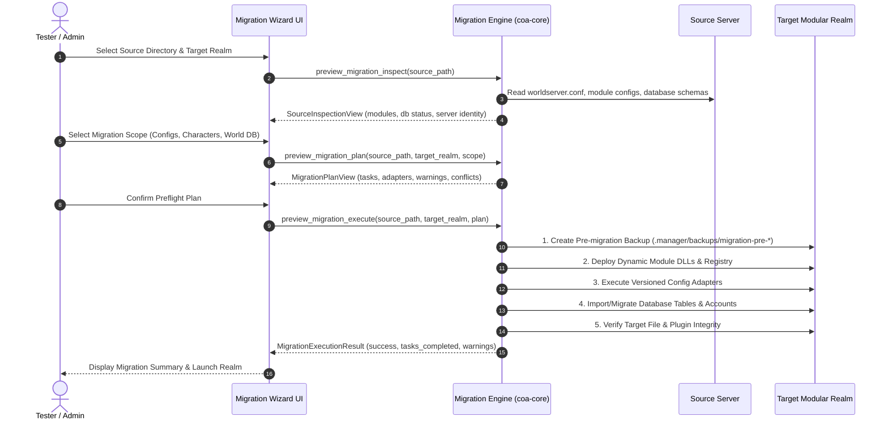

# Server Migration Center — Compatibility & Adapter Specification

## 1. Overview & Architecture

The **Server Migration Center** is an integrated engine and UI wizard within CSM Modules Preview designed to safely transition existing AzerothCore realms (including legacy monolithic `coa-bots` servers) to the modular dynamic host architecture.

The migration subsystem operates through an authoritative 9-step lifecycle:
```
Discover ➔ Inspect ➔ Classify ➔ Compare ➔ Plan ➔ Backup ➔ Transfer ➔ Validate ➔ Commit
```

---

## 2. Migration Lifecycle Stages



---

## 3. Versioned Module Adapters

The migration engine utilizes dedicated, versioned adapters to transform monolithic configs and database states into modular components without data loss:

### 3.1 Supported Migration Adapters

| Adapter Name | Source Module Identity | Target Dynamic Plugin | Configuration Mapping Details |
|---|---|---|---|
| **CompanionsAdapter** | `mod_coa_playerbots` (`mod_coa_playerbots.conf`) | `companions` (`companions.dll`) | Migrates `CoaBots.Enable`, bot limits, companion inventories, and AI party behaviors into `etc/modules/companions.conf`. |
| **SquidPlayerbotsAdapter** | `mod-playerbots` (`playerbots.conf`) | `playerbots` (`squid_playerbots.dll`) | Translates SQUID bot settings (`AiPlayerbot.*`), guild bot flags, and bot combat rotations into `etc/modules/squid_playerbots.conf`. |
| **ContentScalingAdapter** | `mod-content-scaling` (`mod_content_scaling.conf`) | `content-scaling` (`content_scaling.dll`) | Maps health multipliers, damage curves, and dungeon group size auto-scaling into `etc/modules/content_scaling.conf`. |
| **AuctionHouseBotAdapter**| `mod-auction-house-bot` (`mod_ahbot.conf`) | `ah-bot` (`ah-bot.dll`) | Converts auction buyer/seller intervals, item price multipliers, and inventory caps. |
| **NpcEnchanterAdapter** | `mod-npc-enchanter` (`mod_npc_enchanter.conf`) | `npc-enchanter` (`npc-enchanter.dll`) | Converts NPC vendor costs and reagent bypass flags. |
| **CustomRacesAdapter** | `mod-custom-races` | `custom-races` (Client Patch + Script) | Validates client MPQ patches and links character creation hooks. |

---

## 4. Conflict Prevention & Invariants

To avoid gameplay and engine instability, the migration engine strictly enforces the following invariants:

1. **Bot Manager Mutex:**
   - A realm cannot have both `companions` and `playerbots` active simultaneously.
   - If a source realm contains configuration for both bot systems, the migration planner flags a `Warning::BotConflict` and prompts the user to select the active primary bot system before proceeding.
2. **Double-Scaling Prevention:**
   - Monolithic scaling logic embedded in old cores is retired upon transition to modular `worldserver.exe`.
   - The adapter verifies that only `content_scaling.dll` handles creature stat recalculation, preventing compound stat explosion (e.g. bosses receiving 4x health instead of 2x).
3. **Database GUID & Row Preservation:**
   - Character GUIDs, pet IDs, mail items, guild rosters, and bot equipment records in `characters` database are preserved byte-for-byte.
   - Database migration scripts are applied additively without dropping existing user tables.

---

## 5. Rollback & Fault Tolerance

Every migration action is protected by transactional safety:
- **Pre-Migration Safety Snapshot:** Before modifying any file or database in the target realm, the engine creates an uncompressed snapshot in `.manager/backups/migration-pre-<timestamp>/`.
- **Atomic File Writing:** All target configuration and plugin files are written via atomic file replacement (`fsx::atomic_write`).
- **Disaster Recovery:** If any error occurs during file translation, DLL staging, or database copy, the wizard halts execution, restores all files from the snapshot, and reports the exact diagnostic error message to the user.
