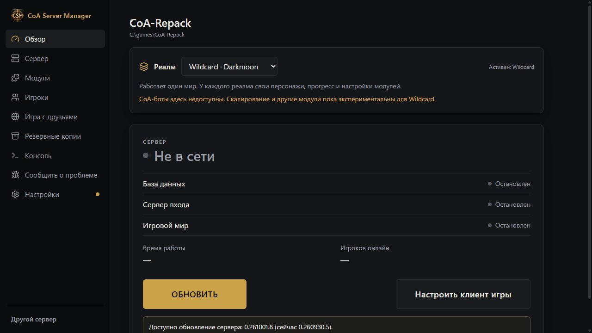
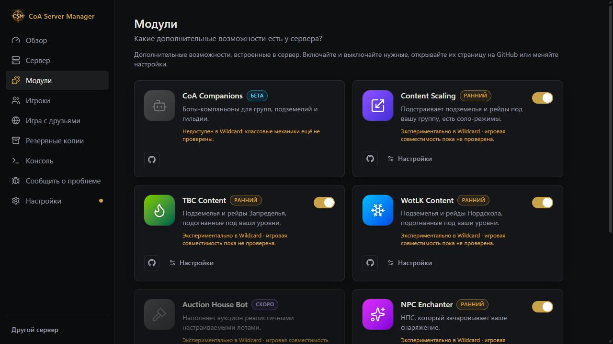

# Realm profiles

**English** · [Русский](ru/WILDCARD.md) · [Deutsch](de/WILDCARD.md) · [Français](fr/WILDCARD.md) · [Español](es/WILDCARD.md) · [简体中文](zh-CN/WILDCARD.md)

Overview offers CoA and Wildcard. The installed worldserver must contain Wildcard support and the database must
already have its Wildcard migrations. The Manager refuses an unsupported binary, an occupied realm ID 2 or an
existing destination database rather than overwrite them.

The first switch copies the CoA world into `acore_world_wildcard` and creates `acore_characters_wildcard` from
the character schema and neutral server seed tables. Existing characters, card collections and progress are not
copied. Accounts remain in shared `acore_auth`. Realm IDs 1 and 2 share the world port; only the selected world
runs, and the inactive realm is listed offline. A switch while running stops the server gracefully and restarts it.

Configuration profiles are saved under `Settings/realm-profiles`. An interrupted switch can restore its previous
configuration from the journal. CoA companion bots cannot be enabled on Wildcard. Content Scaling and the other
optional modules retain their settings but show experimental compatibility; class mechanics need separate gameplay
validation. Switching back restores the CoA module settings.

Quick/database backups include both character databases and shared auth. Full backups also include both worlds.
Recovery points identify their active realm; select that realm before restoring them. Server migrations apply to
both realms, with auth applied once. The server updater can replace its launcher: the Manager reapplies the realm
adapter before the next start.

[All guides](README.md)
