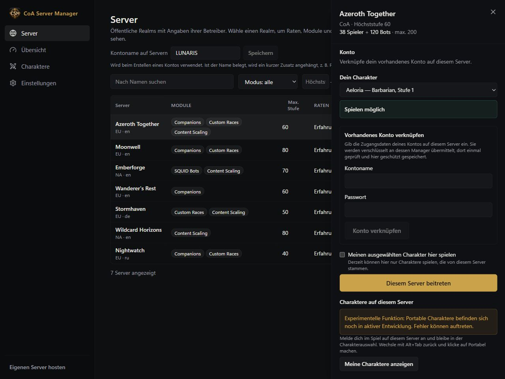
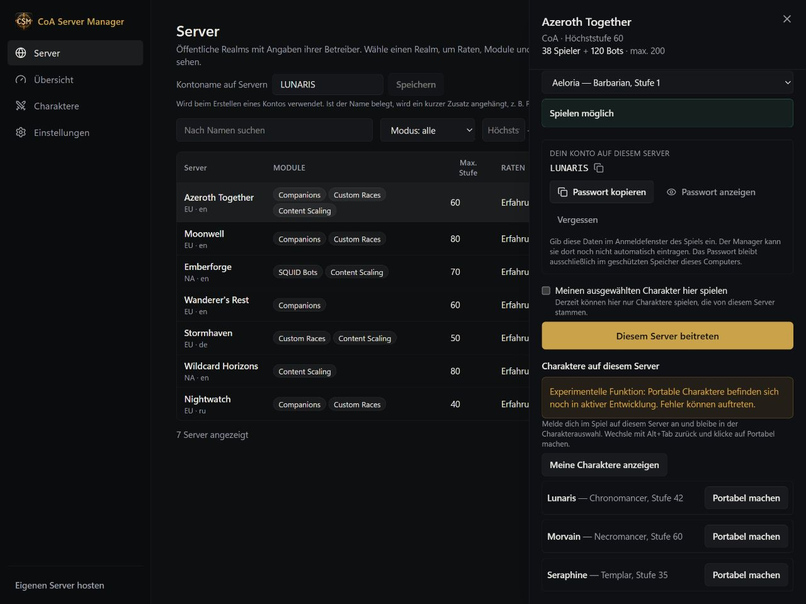
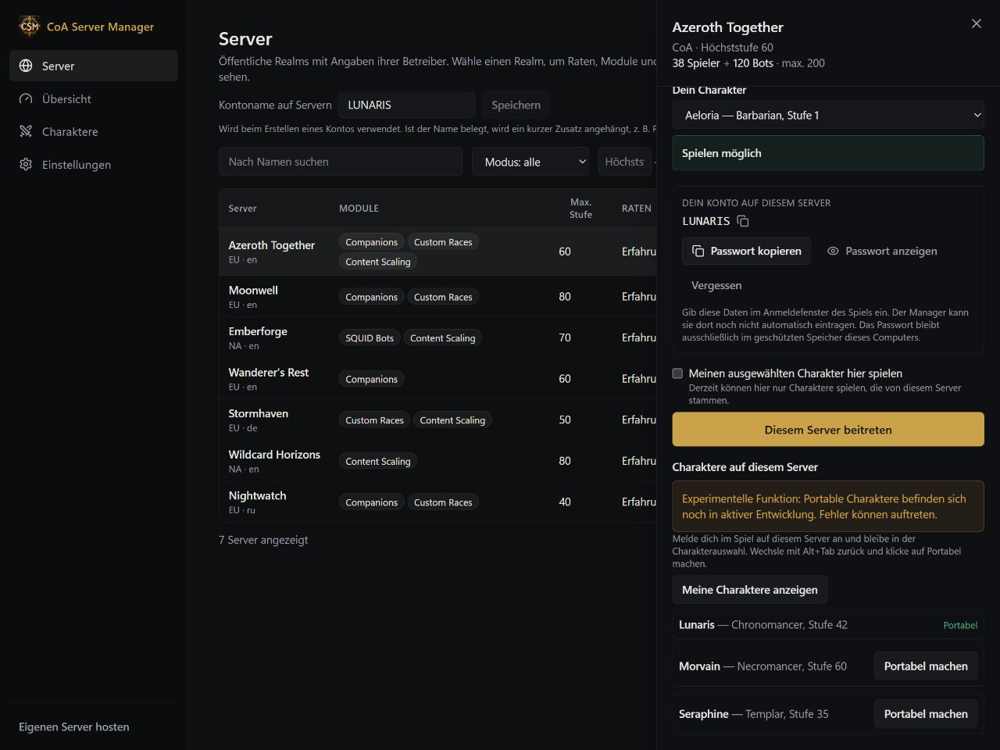

# Deinen Charakter mitnehmen

[English](../PORTABLE-CHARACTERS.md) · [Русский](../ru/PORTABLE-CHARACTERS.md) · **Deutsch** · [Français](../fr/PORTABLE-CHARACTERS.md) · [Español](../es/PORTABLE-CHARACTERS.md) · [简体中文](../zh-CN/PORTABLE-CHARACTERS.md)

**Portable Characters sind experimentell.** Die Funktion wird noch entwickelt und kann Fehler enthalten.

Der Manager kann einen Charakter speichern, mit dem du anschließend auf kompatiblen CoA-Realms spielst.

## Den ersten Charakter übernehmen

1. Logge den Charakter im Spiel aus. Lass den Manager geöffnet.
2. Öffne **Charaktere (Characters)** und wähle **Vorhandenen Charakter portabel machen (Make an existing character portable)**.
3. Wähle einen Realm, auf den du Zugriff hast, und den gewünschten Charakter.
4. Klicke auf **Portabel machen (Make portable)**. Der Charakter erscheint unter **Deine Charaktere (Your characters)**.

Lässt sich ein Charakter nicht auswählen, steht der Grund daneben. Bot-Charaktere, laufende Herausforderungen und bestimmte ausstehende Belohnungen können die Übernahme verhindern. Die portable Kopie löscht den ursprünglichen Realm-Charakter nicht.

## Einen Charakter von einem anderen Realm übernehmen

1. Öffne **Server (Servers)** und wähle den Realm des Charakters.
2. Wähle **Vorhandenes Konto verknüpfen (Link an existing account)** und gib dein vorhandenes Konto dieses Realms an.
3. Melde dich im Spiel auf dem Realm an und bleibe in der Charakterauswahl.
4. Wechsle mit **Alt+Tab** zurück zum Manager und wähle **Meine Charaktere anzeigen (Show my characters)**.
5. Suche deinen Charakter und klicke auf **Portabel machen (Make portable)**.
6. Warte auf die Bestätigung und die Kennzeichnung **Portable**.

## Mit dem gespeicherten Charakter spielen

1. Suche einen kompatiblen Realm: im Spielermodus unter **Servers**, beim Hosting unter **Mit Freunden spielen (Play with Friends)**. Du kannst auch einen bereits im Manager verfügbaren Realm verwenden.
2. Wähle deinen portablen Charakter und lies die Kompatibilitätshinweise, bevor du **Play** anklickst.
3. Folge der Kontoabfrage. Manche Hosts legen ein Konto an, andere verlangen ein bereits bestehendes.
4. Starte das Spiel, sobald der Manager meldet, dass der Charakter bereit ist.
5. Lass den Manager beim Spielen offen. Logge dich aus und warte, bis der Fortschritt vollständig gespeichert ist, bevor du ihn schließt oder den Realm wechselst.

Auf Realms mit einer niedrigeren Höchststufe kann dein Charakter vorübergehend auf einer niedrigeren Stufe gespielt werden. Lies die Warnung: Nicht unterstützte Inhalte werden zurückgehalten, statt stillschweigend gelöscht zu werden. Der Server muss die Funktion unterstützen; die Installation des Managers allein reicht nicht aus.

## Gespeicherte Versionen und Konflikte

Unter **Gespeicherte Versionen (Saved versions)** siehst du, wann dein Fortschritt gespeichert wurde. Bei einem Konflikt lies zuerst die Erklärung des Managers. Spiele nicht mit zwei Kopien gleichzeitig und behalte zusätzlich normale Serversicherungen.

[Alle Anleitungen](README.md)

## Portable Charaktere und Relay

Aktiviere in der Karte zur öffentlichen Realmliste „Portable Charaktere auf diesem Realm erlauben“ und speichere. Ohne Zustimmung des Betreibers bleibt der Zugang gesperrt. Ausschalten verhindert neue Exporte und Importe, löscht aber keine gespeicherten Charaktere. Der Manager des Betreibers muss laufen. Steuerverbindung und Spiel-Relay haben getrennte Statusanzeigen; eine Steuerverbindung allein ist noch kein Spieltunnel. Charaktere bleiben in ihrem ursprünglichen Spielmodus: CoA, Wildcard oder Warcraft Reborn.

Lass beide Manager laufen. Nach Verbindungsabbrüchen oder Neustarts wird ausstehender Fortschritt weiter gespeichert; auch spätere Anmeldungen werden überwacht. Warte vor dem Realmwechsel auf den Abschluss. Eigene installierte Server nutzen die lokale Vorbereitung und Wiederherstellung. Experimentelle Einschränkung: Eine ältere Kopie bei einem anderen Host lässt sich auf dessen laufendem Worldserver noch nicht automatisch aktualisieren. Die Rückkehr kann Wartungsarbeiten des Hosts erfordern. Die alte Kopie wird blockiert, dein kanonischer Charakter bleibt gespeichert. Lösche den Charakter nicht und installiere den Server nicht neu, um die Meldung zu umgehen.
