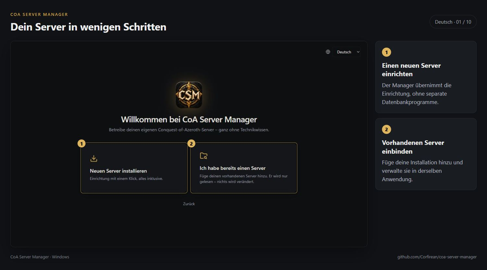
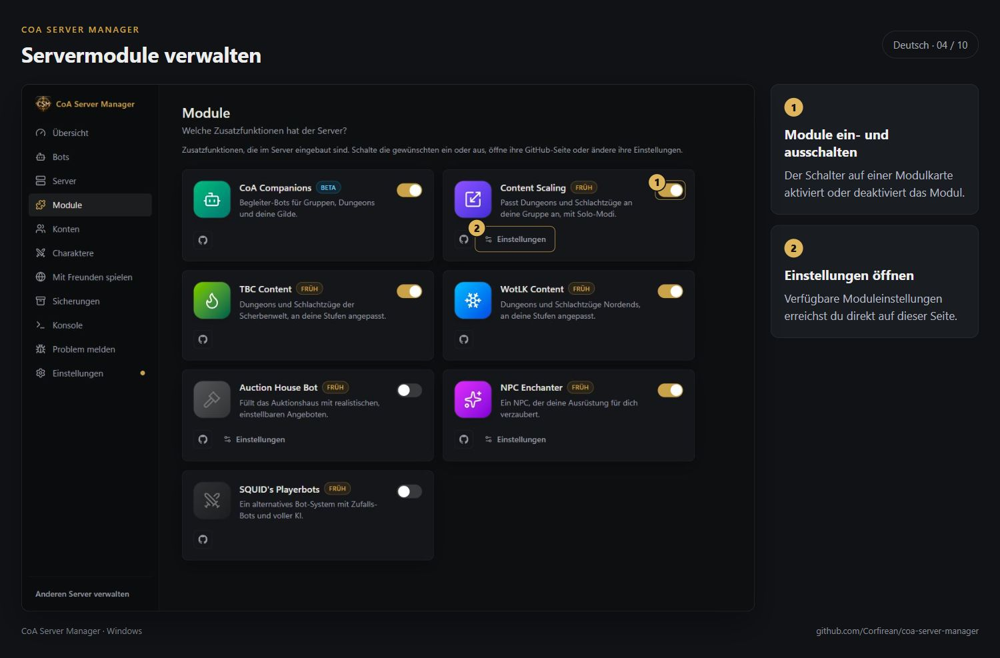
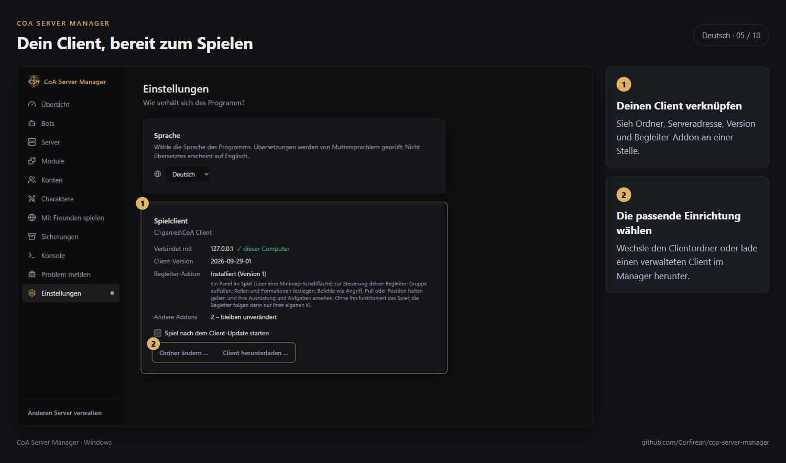
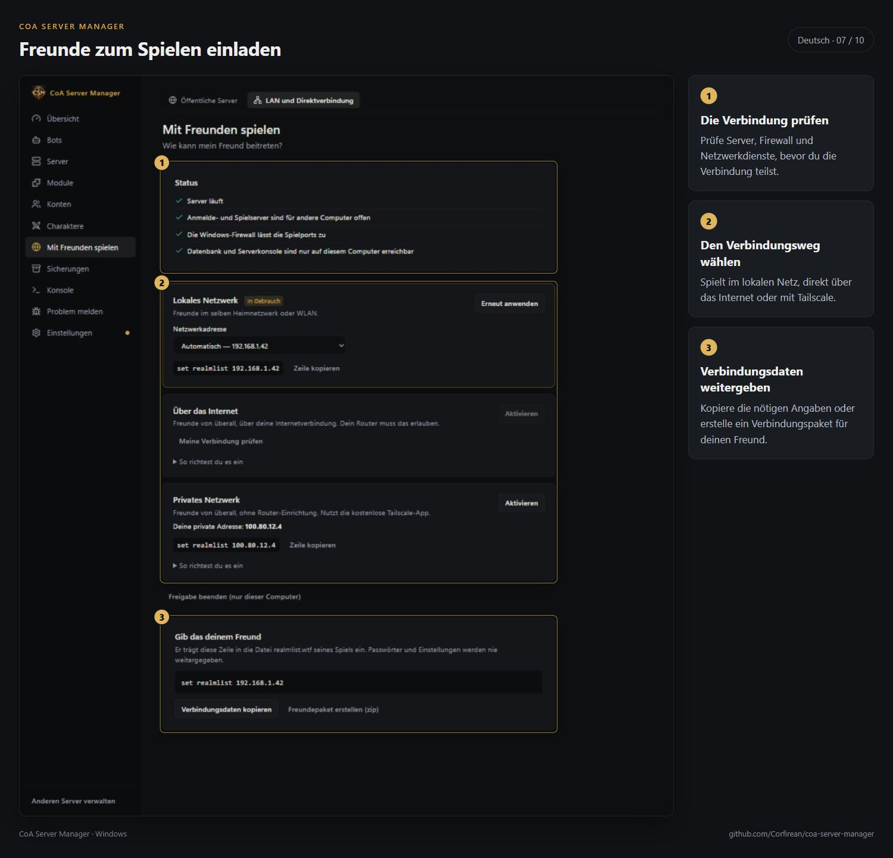
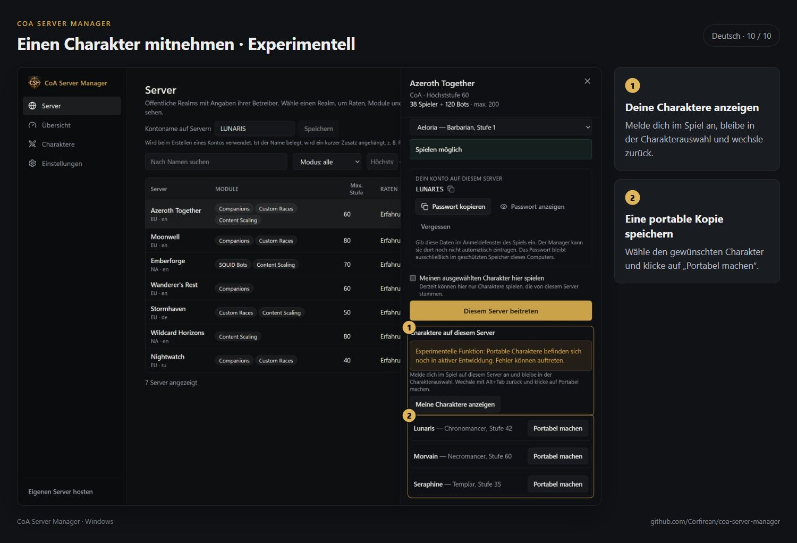

# CoA Server Manager — Galerie

[English](../SCREENSHOTS.md) · [Русский](../ru/SCREENSHOTS.md) · **Deutsch** · [Français](../fr/SCREENSHOTS.md) · [Español](../es/SCREENSHOTS.md) · [简体中文](../zh-CN/SCREENSHOTS.md)

Die Screenshots zeigen die deutsche Oberfläche.

[Alle Anleitungen](README.md)
