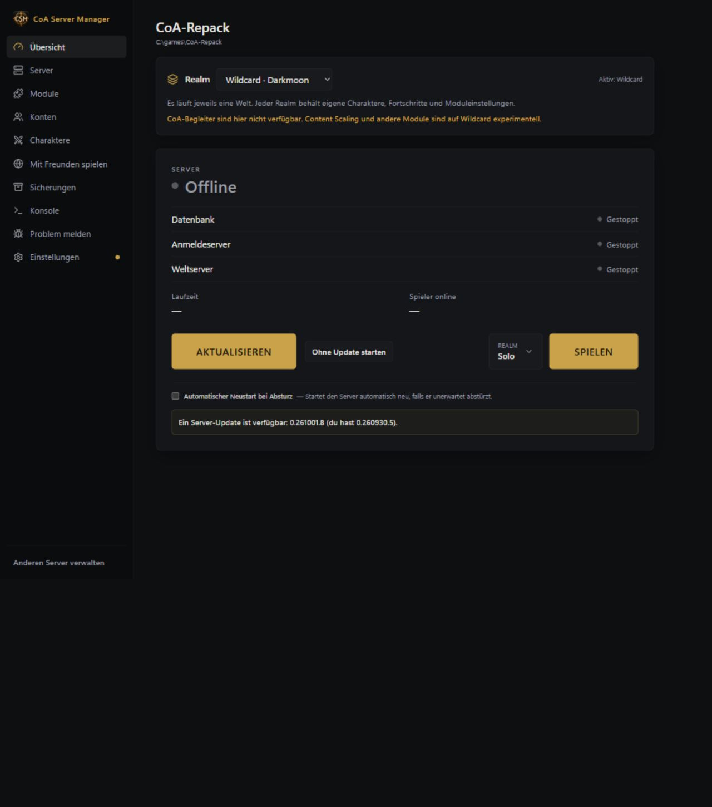
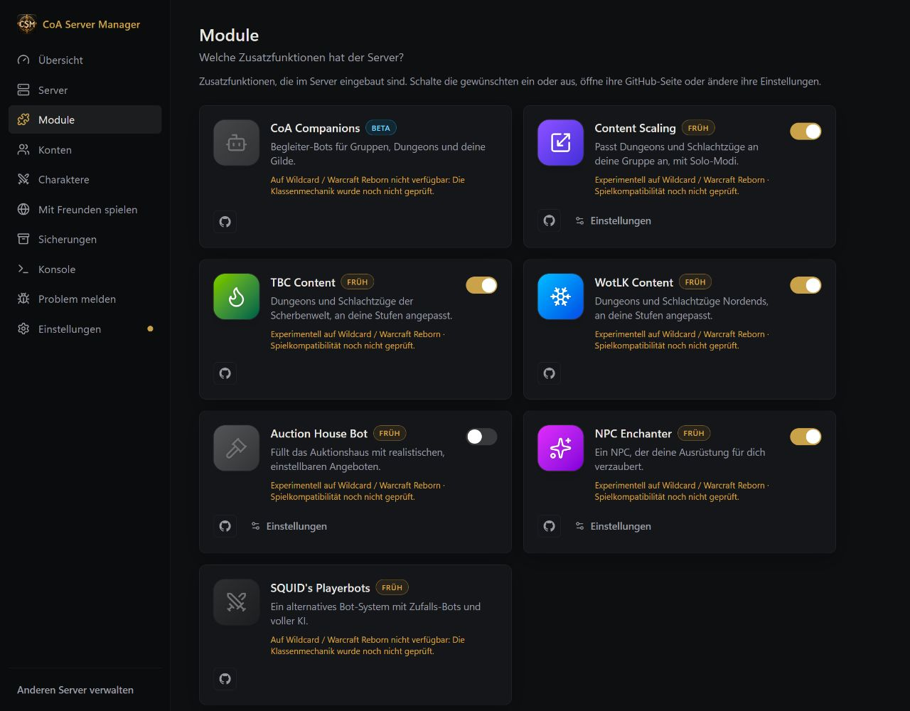

# Realm-Profile: CoA und Wildcard

[English](../WILDCARD.md) · [Русский](../ru/WILDCARD.md) · **Deutsch** · [Français](../fr/WILDCARD.md) · [Español](../es/WILDCARD.md) · [简体中文](../zh-CN/WILDCARD.md)

Unter **Übersicht (Overview)** kannst du CoA oder Wildcard auswählen. Server und Datenbank müssen Wildcard unterstützen. Bei einer ungeeigneten Serverversion, belegter Realm-ID `2` oder bereits vorhandener Zieldatenbank bricht der Manager ab, anstatt Daten zu überschreiben.

Beim ersten Wechsel wird die CoA-Welt nach `acore_world_wildcard` kopiert. `acore_characters_wildcard` erhält die Tabellenstruktur und neutrale Startdaten, jedoch keine vorhandenen Charaktere, Kartensammlungen oder Fortschritte. Konten bleiben gemeinsam in `acore_auth`. Im normalen Einzelbetrieb teilen die Realm-IDs `1` und `2` den Welt-Port; nur der ausgewählte Realm läuft, der andere erscheint offline. Ein Wechsel bei laufendem Server beendet ihn geordnet und startet das neue Profil.

Profile liegen unter `Settings/realm-profiles`. Bei einer Unterbrechung lässt sich die vorherige Konfiguration aus dem Journal wiederherstellen. CoA-Begleiter-Bots sind auf Wildcard nicht verfügbar. Content Scaling und andere Zusatzmodule behalten ihre Einstellungen, ihre Kompatibilität gilt dort aber als experimentell; Klassenmechaniken müssen gesondert im Spiel geprüft werden. Beim Wechsel zurück werden die CoA-Moduleinstellungen wiederhergestellt.

Schnell- und Datenbanksicherungen umfassen beide Charakterdatenbanken und die gemeinsamen Konten. Vollständige Sicherungen enthalten auch beide Welten. Wähle vor dem Wiederherstellen den im Wiederherstellungspunkt angegebenen Realm. Serverupdates bearbeiten beide Realms und die gemeinsame Kontendatenbank einmal. Wird der Serverlauncher ersetzt, richtet der Manager den Realm-Adapter vor dem nächsten Start erneut ein.

[Alle Anleitungen](README.md) · [Beide Realms gemeinsam starten](REPAIR_AND_REALMS.md)
