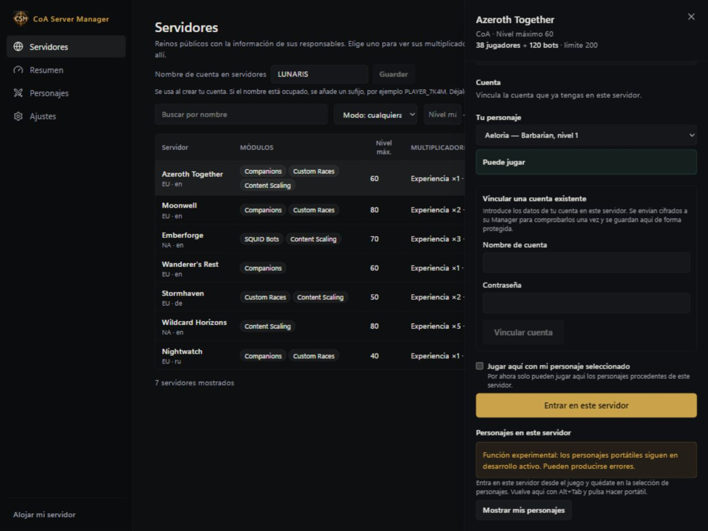
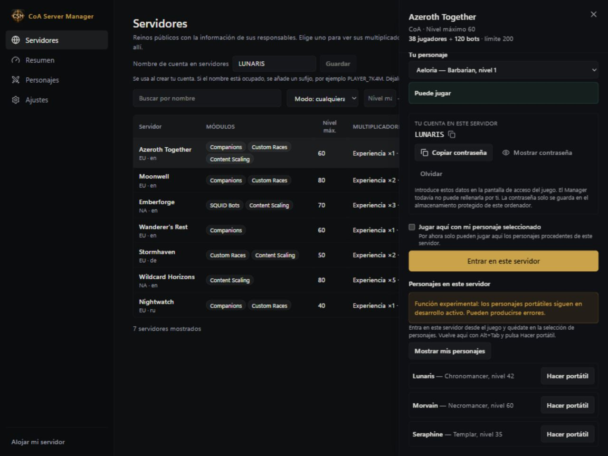
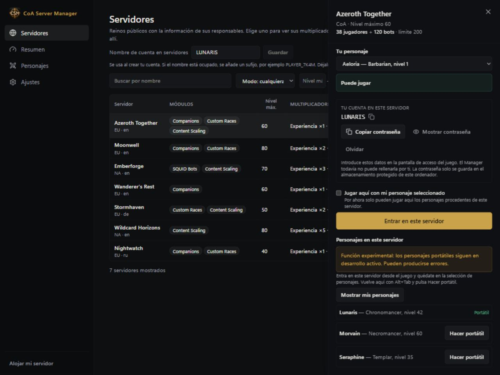

# Lleva tu personaje a otros reinos

[English](../PORTABLE-CHARACTERS.md) · [Русский](../ru/PORTABLE-CHARACTERS.md) · [Deutsch](../de/PORTABLE-CHARACTERS.md) · [Français](../fr/PORTABLE-CHARACTERS.md) · **Español** · [简体中文](../zh-CN/PORTABLE-CHARACTERS.md)

**Los personajes portátiles son experimentales.** La función sigue en desarrollo y puede tener errores.

El Manager guarda una copia de tu personaje para jugar con él en reinos CoA compatibles.

## Crea tu primer personaje portátil

1. Desconecta al personaje en el juego y deja el Manager abierto.
2. Abre **Personajes (Characters)** y elige **Convertir un personaje existente en portátil (Make an existing character portable)**.
3. Selecciona un reino al que tengas acceso y después tu personaje.
4. Pulsa **Hacer portátil (Make portable)**. Aparecerá en **Tus personajes (Your characters)**.

Si no puedes seleccionar un personaje, lee el motivo que aparece junto a él. Los bots, los desafíos activos y algunas recompensas pendientes pueden impedir la operación. Crear la copia portátil no elimina el personaje original del reino.

## Usa un personaje de otro reino

1. En **Servidores (Servers)**, selecciona el reino donde está el personaje.
2. Elige **Vincular una cuenta existente (Link an existing account)** e indica la cuenta que ya utilizas allí.
3. Entra en ese reino desde el juego y quédate en la selección de personajes.
4. Vuelve al Manager con **Alt+Tab** y pulsa **Mostrar mis personajes (Show my characters)**.
5. Busca tu personaje y pulsa **Hacer portátil (Make portable)**.
6. Espera la confirmación y la etiqueta **Portable**.

## Juega con tu personaje portátil

1. Busca un servidor compatible en **Servers** si estás en modo jugador, o en **Jugar con amigos (Play with Friends)** si alojas un servidor. También puedes usar un reino que ya tengas disponible en el Manager.
2. Elige tu personaje y revisa la compatibilidad antes de pulsar **Play**.
3. Sigue el paso de la cuenta: algunos servidores crean una para ti y otros exigen una existente.
4. Abre el juego cuando el Manager indique que el personaje está listo.
5. Mantén el Manager abierto mientras juegas. Al salir del mundo, espera a que termine de guardar el progreso antes de cerrar la aplicación o cambiar de reino.

Si el reino tiene un nivel máximo menor, tu personaje puede jugar temporalmente a un nivel reducido. Lee el aviso: el contenido no compatible se deja en reserva, en lugar de borrarse sin avisar. El servidor debe admitir la función; instalar el Manager no vuelve compatible cualquier servidor.

## Versiones guardadas y conflictos

En **Versiones guardadas (Saved versions)** puedes ver cuándo se guardó el progreso. Si aparece un conflicto, lee la explicación antes de continuar. Evita jugar con dos copias a la vez y conserva también las copias normales del servidor.

[Todas las guías](README.md)

## Personajes portátiles y relay

En la tarjeta de publicación del reino, activa «Permitir personajes portátiles en este reino» y guarda. El acceso está desactivado por defecto. Desactivarlo impide nuevas exportaciones e importaciones sin borrar personajes guardados. El Manager del anfitrión debe permanecer abierto. La conexión de control y el relay del juego muestran estados separados: un canal de control conectado no garantiza un túnel de juego. Los personajes conservan su modo original: CoA, Wildcard o Warcraft Reborn.

Mantén abiertos ambos Managers. Tras una desconexión o reinicio, el progreso pendiente vuelve a guardarse; también se supervisan los siguientes inicios de sesión. Espera a que termine antes de cambiar de reino. Tus servidores instalados usan la preparación y recuperación locales. Limitación experimental: una copia antigua en otro anfitrión todavía no se actualiza automáticamente mientras su worldserver está en ejecución. Volver puede requerir mantenimiento del anfitrión. Esa copia se bloquea y tu personaje canónico queda guardado. No borres el personaje ni reinstales el servidor para evitar este mensaje.
