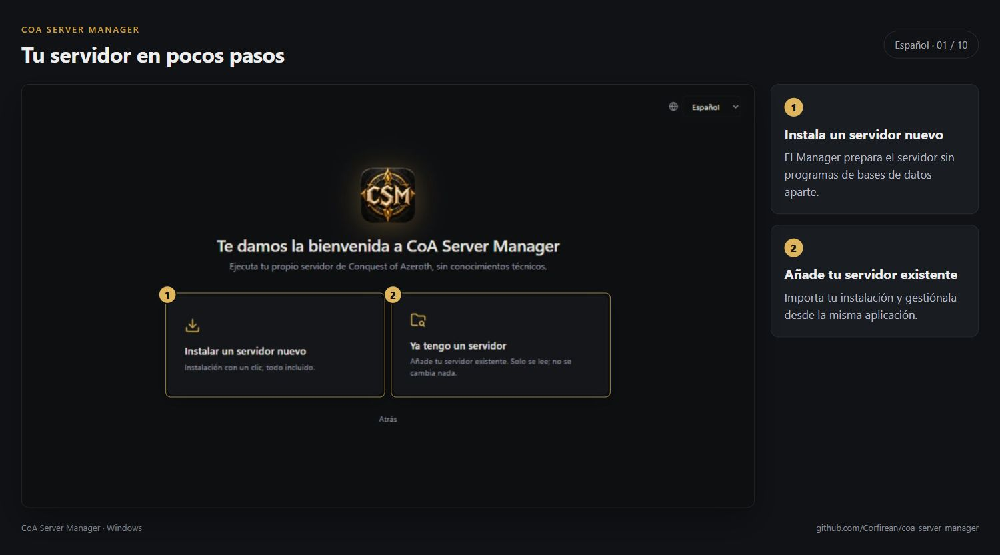
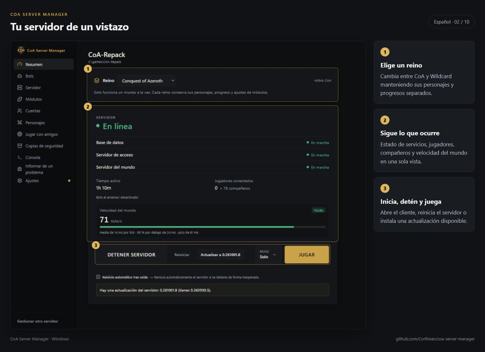
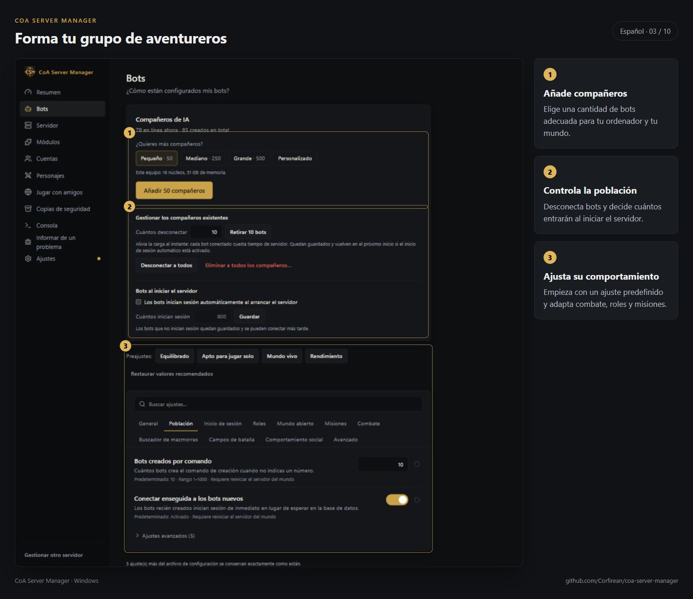
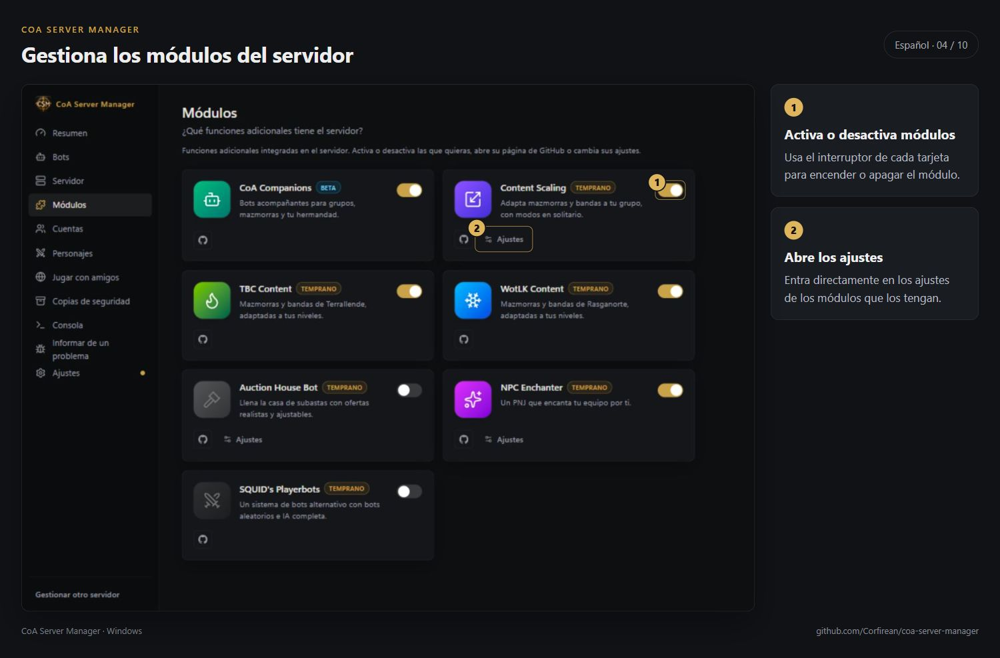
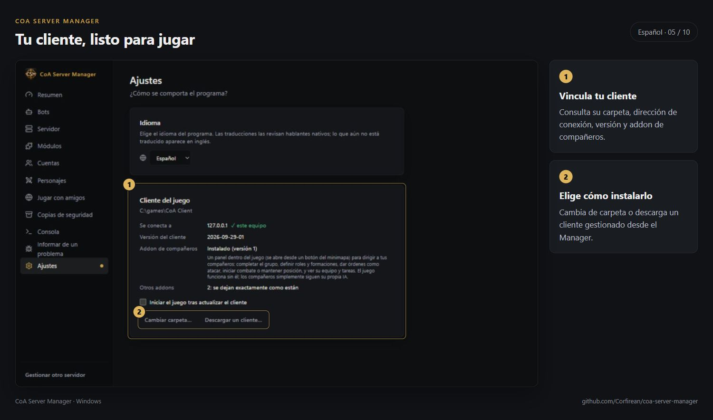
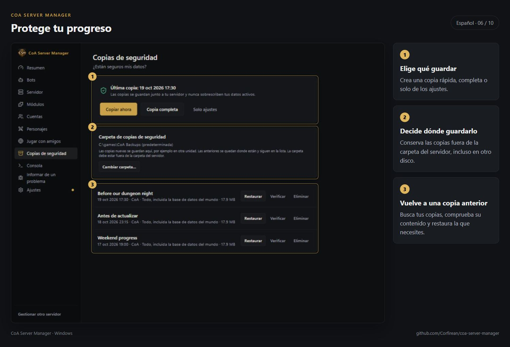
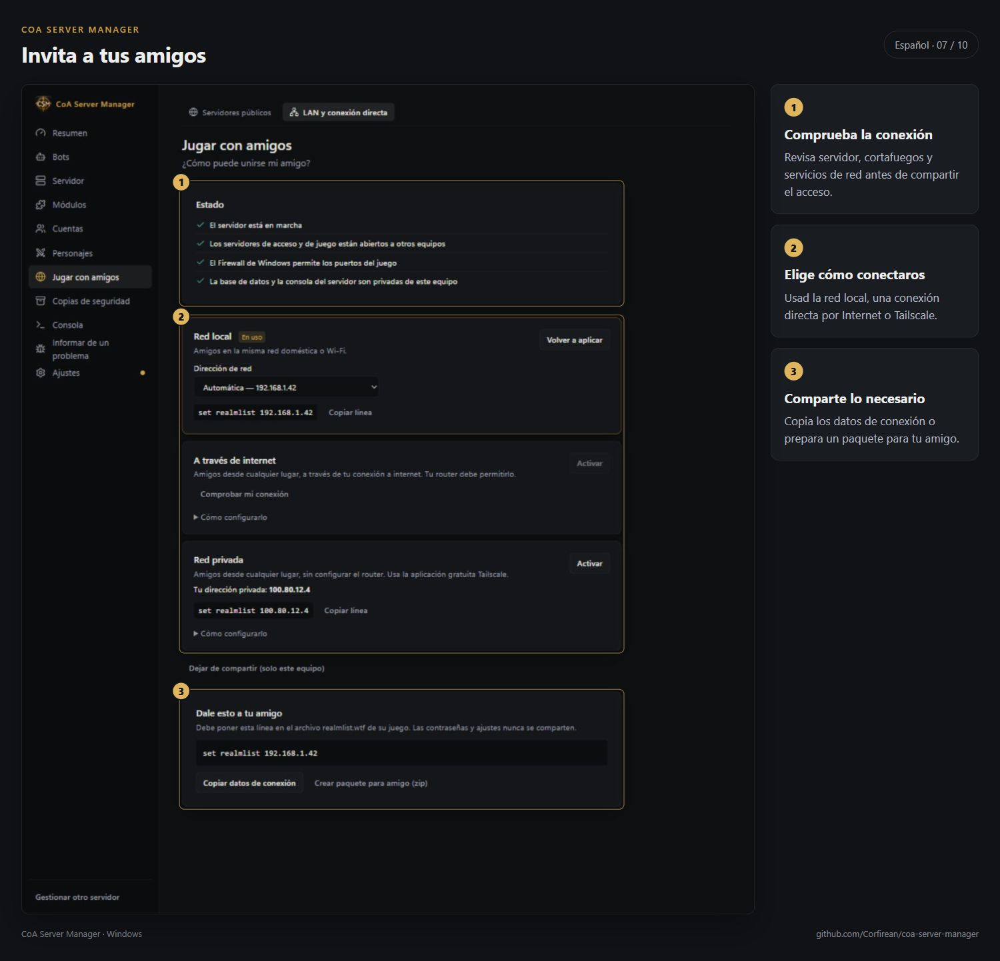
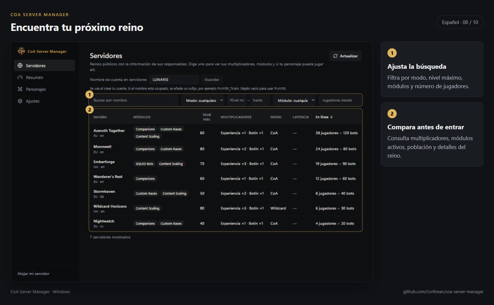
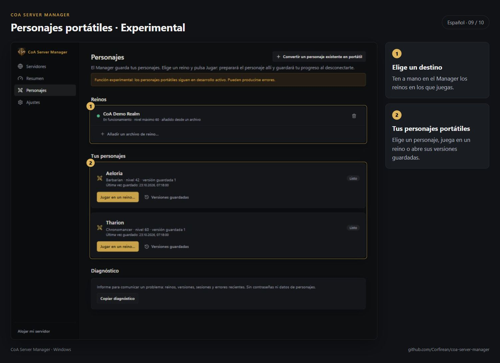
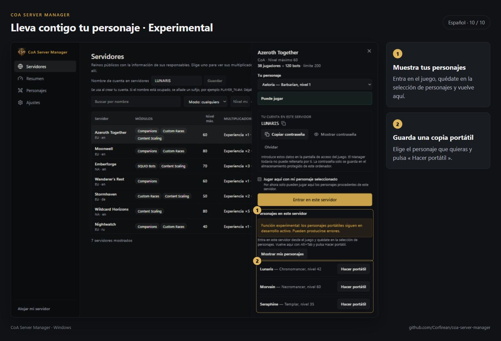

# CoA Server Manager — galería

[English](../SCREENSHOTS.md) · [Русский](../ru/SCREENSHOTS.md) · [Deutsch](../de/SCREENSHOTS.md) · [Français](../fr/SCREENSHOTS.md) · **Español** · [简体中文](../zh-CN/SCREENSHOTS.md)

Las capturas muestran la interfaz en español.

[Todas las guías](README.md)
