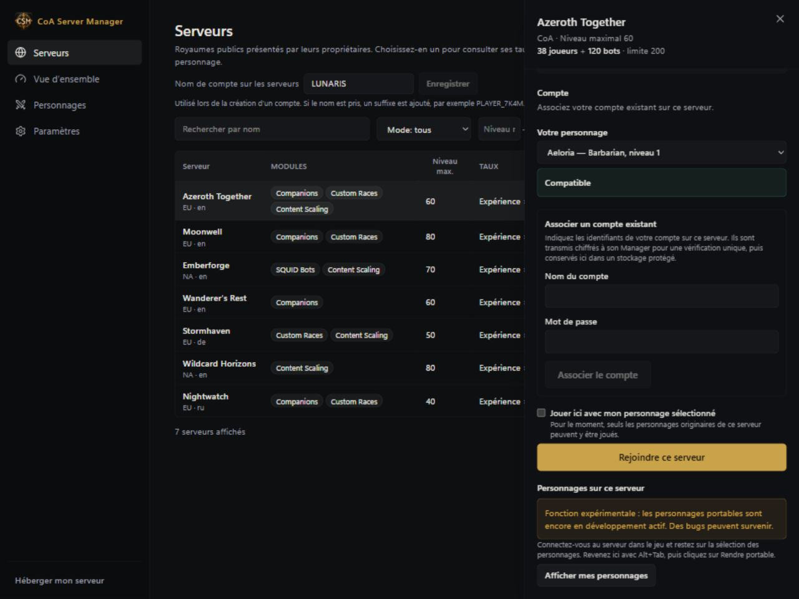
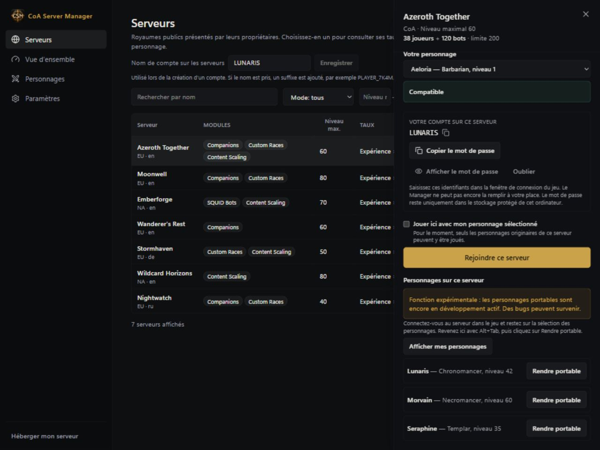
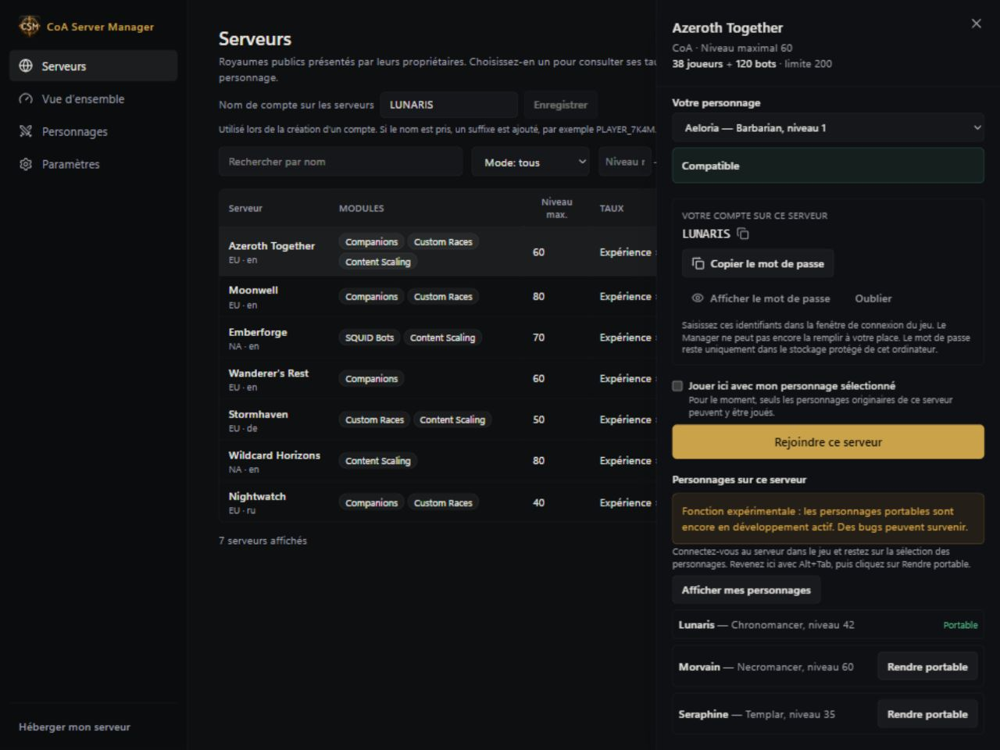

# Emporter son personnage sur un autre royaume

[English](../PORTABLE-CHARACTERS.md) · [Русский](../ru/PORTABLE-CHARACTERS.md) · [Deutsch](../de/PORTABLE-CHARACTERS.md) · **Français** · [Español](../es/PORTABLE-CHARACTERS.md) · [简体中文](../zh-CN/PORTABLE-CHARACTERS.md)

**Les personnages portables sont expérimentaux.** Cette fonction est encore en développement et peut présenter des bugs.

Le Manager conserve une copie sauvegardée de votre personnage, utilisable sur les royaumes CoA compatibles.

## Créer son premier personnage portable

1. Déconnectez le personnage dans le jeu. Laissez le Manager ouvert.
2. Ouvrez **Personnages (Characters)** et choisissez **Rendre un personnage existant portable (Make an existing character portable)**.
3. Sélectionnez un royaume auquel vous avez accès, puis votre personnage.
4. Cliquez sur **Rendre portable (Make portable)**. Le personnage apparaît dans **Vos personnages (Your characters)**.

Si un personnage n'est pas sélectionnable, consultez la raison affichée à côté. Les bots, les défis en cours et certaines récompenses en attente peuvent empêcher l'opération. La copie portable ne supprime pas le personnage d'origine sur son royaume.

## Récupérer un personnage d'un autre royaume

1. Dans **Serveurs (Servers)**, sélectionnez le royaume du personnage.
2. Choisissez **Associer un compte existant (Link an existing account)** et indiquez le compte que vous utilisez sur ce royaume.
3. Connectez-vous au royaume dans le jeu et restez sur l'écran de sélection des personnages.
4. Revenez au Manager avec **Alt+Tab** et cliquez sur **Afficher mes personnages (Show my characters)**.
5. Trouvez votre personnage et cliquez sur **Rendre portable (Make portable)**.
6. Attendez la confirmation et l'indication **Portable**.

## Jouer avec le personnage portable

1. Trouvez un serveur compatible dans **Servers** en mode joueur ou dans **Jouer avec des amis (Play with Friends)** si vous hébergez. Vous pouvez aussi utiliser un royaume déjà accessible dans le Manager.
2. Choisissez votre personnage et lisez les indications de compatibilité avant de cliquer sur **Play**.
3. Suivez l'étape concernant le compte. Certains hôtes en créent un pour vous ; d'autres demandent un compte existant.
4. Lancez le jeu lorsque le Manager indique que le personnage est prêt.
5. Gardez le Manager ouvert pendant la partie. Après déconnexion, attendez la fin de l'enregistrement du progrès avant de fermer l'application ou de changer de royaume.

Sur un royaume dont le niveau maximal est inférieur, votre personnage peut temporairement jouer à un niveau réduit. Lisez l'avertissement : les éléments non pris en charge sont mis de côté plutôt que supprimés sans vous prévenir. Le serveur doit être compatible ; installer le Manager ne suffit pas à activer cette fonction sur tous les serveurs.

## Versions sauvegardées et conflits

**Versions sauvegardées (Saved versions)** permet de voir quand le progrès a été enregistré. Si un conflit apparaît, lisez l'explication avant de continuer. Évitez de jouer avec deux copies simultanément et conservez aussi des sauvegardes classiques du serveur.

[Tous les guides](README.md)

## Personnages portables et relais

Dans la carte de publication du royaume, activez « Autoriser les personnages portables sur ce royaume », puis enregistrez. Cet accès est désactivé par défaut. Le désactiver bloque les nouveaux exports et imports sans supprimer les personnages sauvegardés. Le Manager de l’hôte doit rester ouvert. La connexion de contrôle et le relais de jeu ont des états distincts : un canal de contrôle connecté ne suffit pas à établir un tunnel de jeu. Chaque personnage conserve son mode d’origine : CoA, Wildcard ou Warcraft Reborn.

Gardez les deux Managers ouverts. Après une coupure ou un redémarrage, la sauvegarde reprend ; les connexions suivantes restent suivies. Attendez la fin avant de changer de royaume. Vos serveurs installés utilisent la préparation et la récupération locales. Limite expérimentale : une ancienne copie chez un autre hôte ne peut pas encore être actualisée automatiquement sur son worldserver en cours d’exécution. Le retour peut nécessiter une maintenance par l’hôte. Cette copie est bloquée et votre personnage canonique reste enregistré. Ne supprimez pas le personnage et ne réinstallez pas le serveur pour contourner ce message.

Arrêtez le serveur avant la première activation. L’enregistrement prépare les sessions portables pour le prochain démarrage. Bloquer les nouveaux accès ne coupe pas les sessions en cours.
