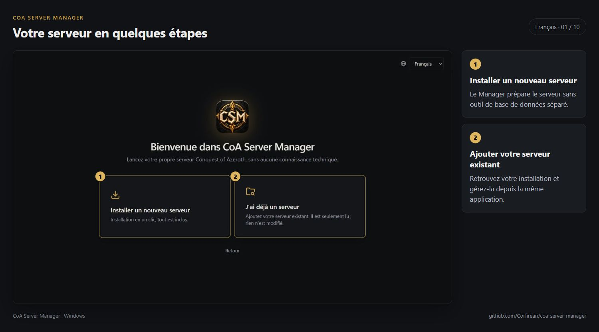
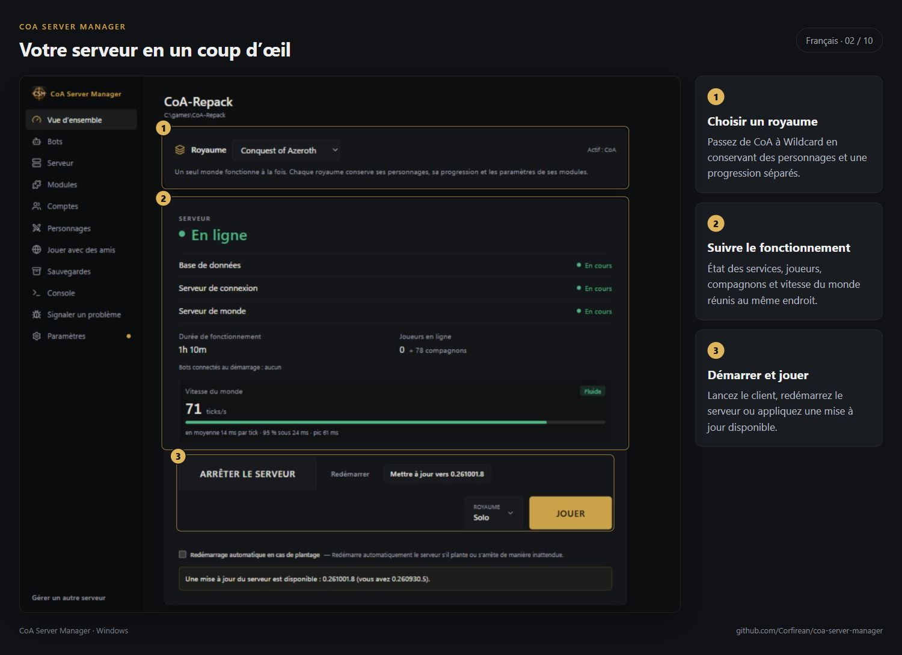
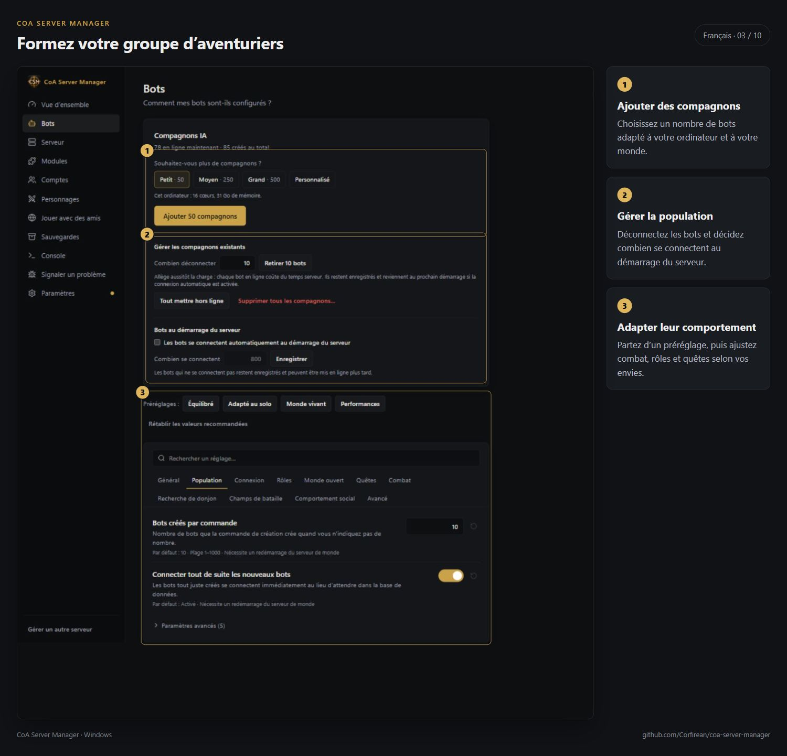
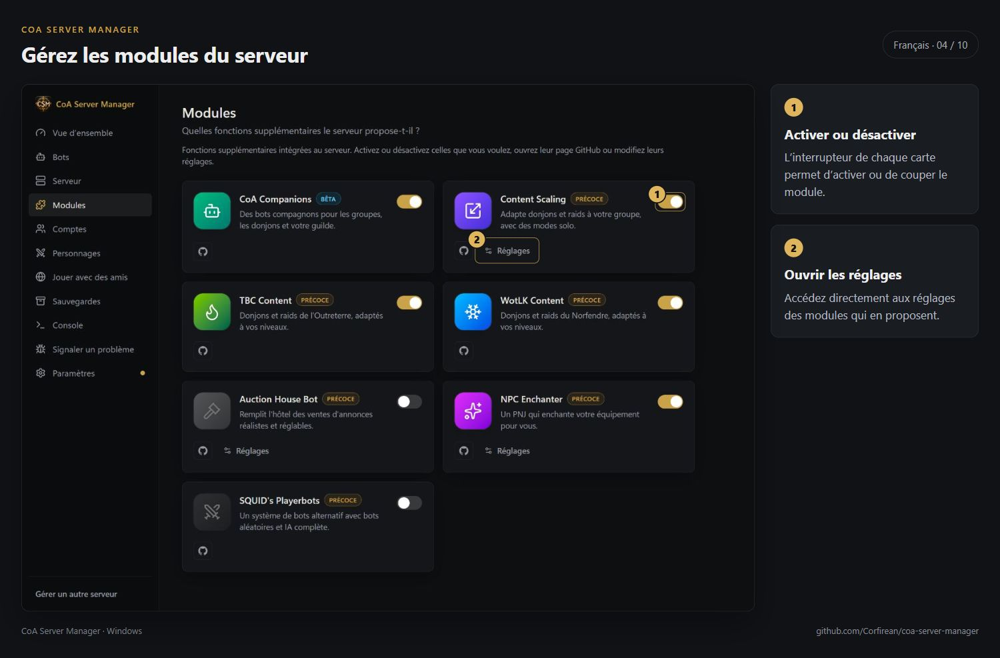
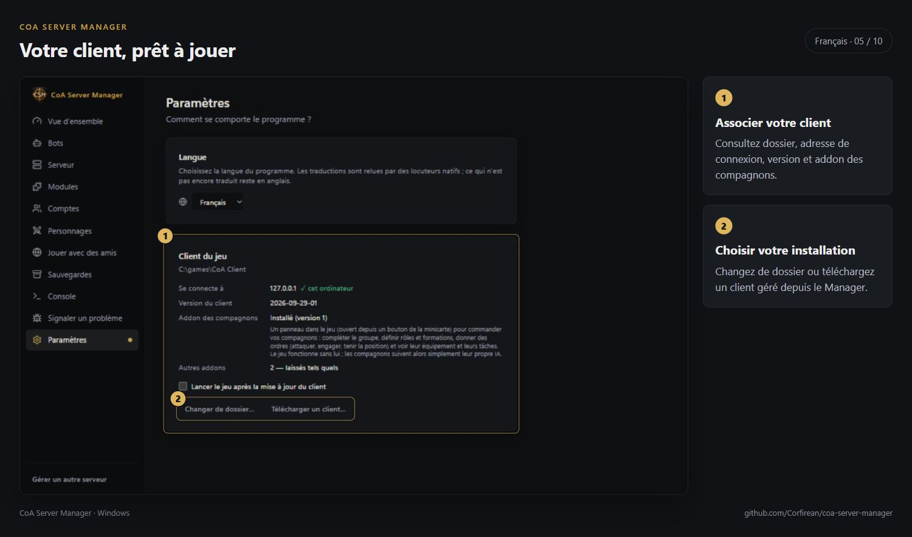
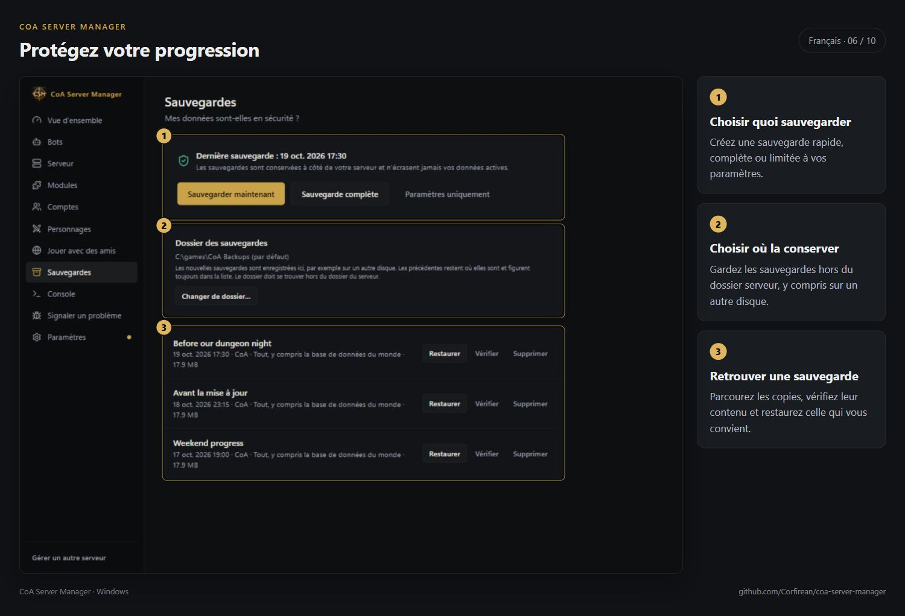
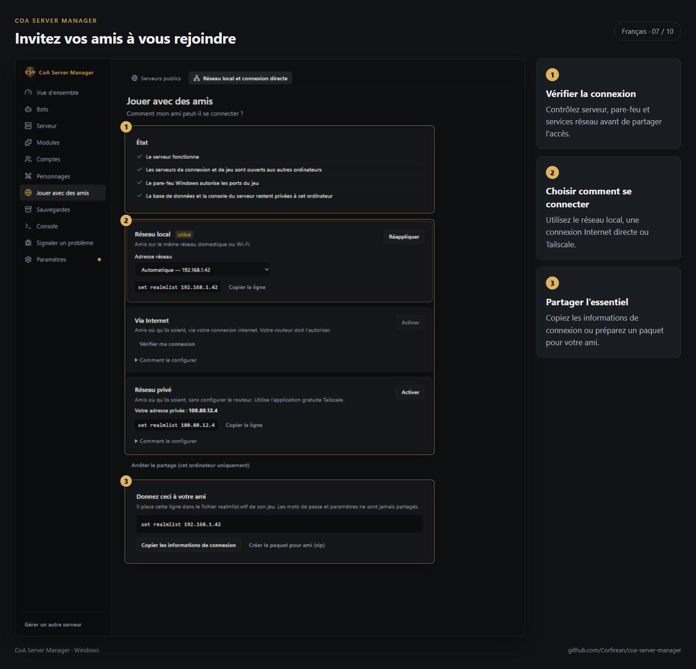
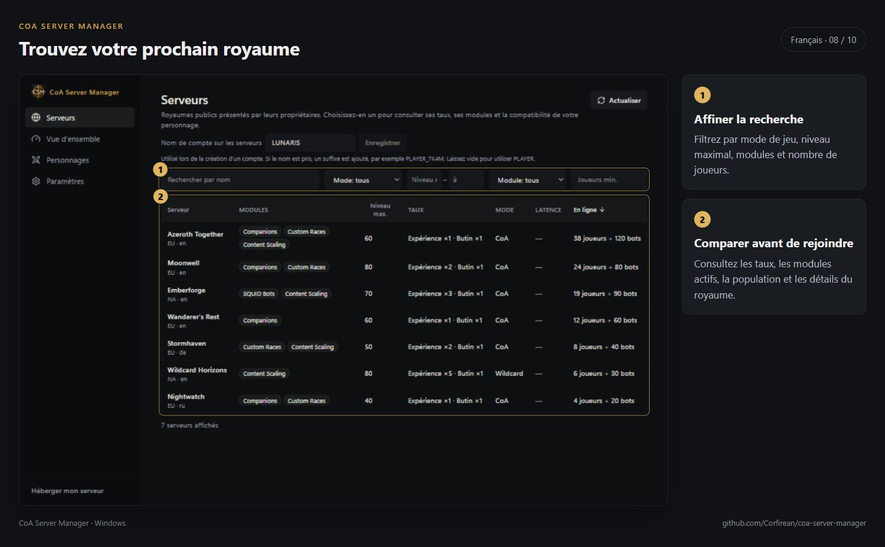
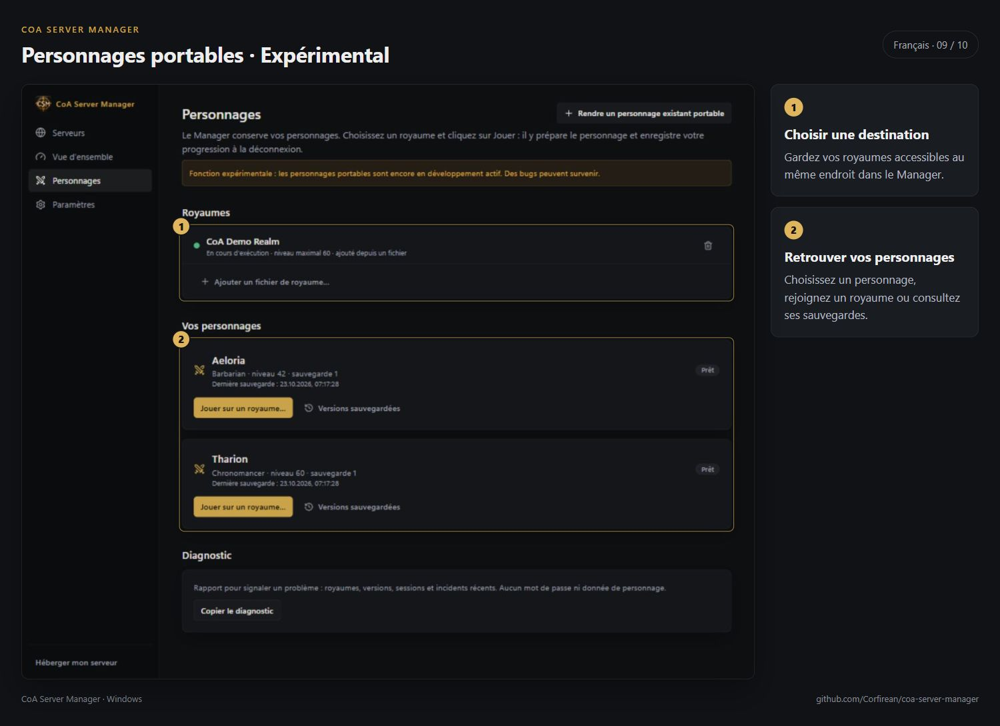
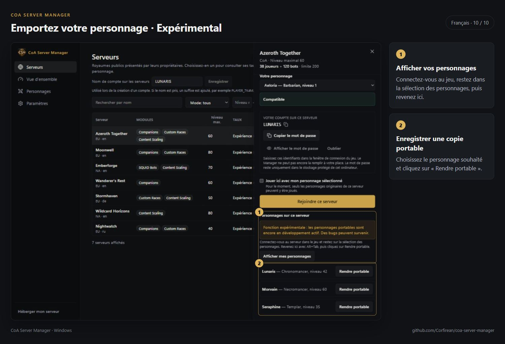

# CoA Server Manager — galerie

[English](../SCREENSHOTS.md) · [Русский](../ru/SCREENSHOTS.md) · [Deutsch](../de/SCREENSHOTS.md) · **Français** · [Español](../es/SCREENSHOTS.md) · [简体中文](../zh-CN/SCREENSHOTS.md)

Les captures présentent l’interface en français.

[Tous les guides](README.md)
