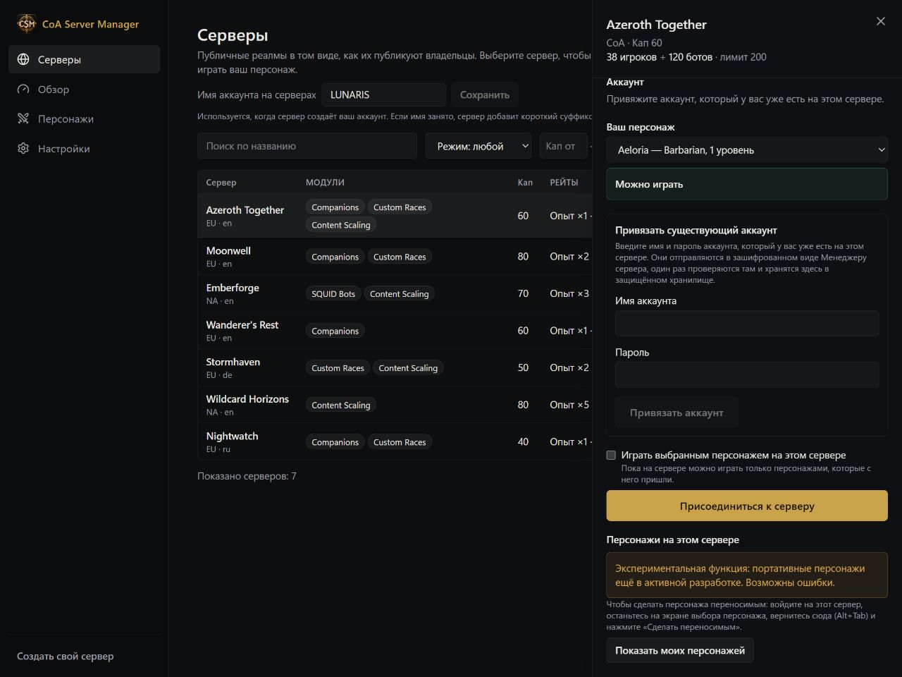
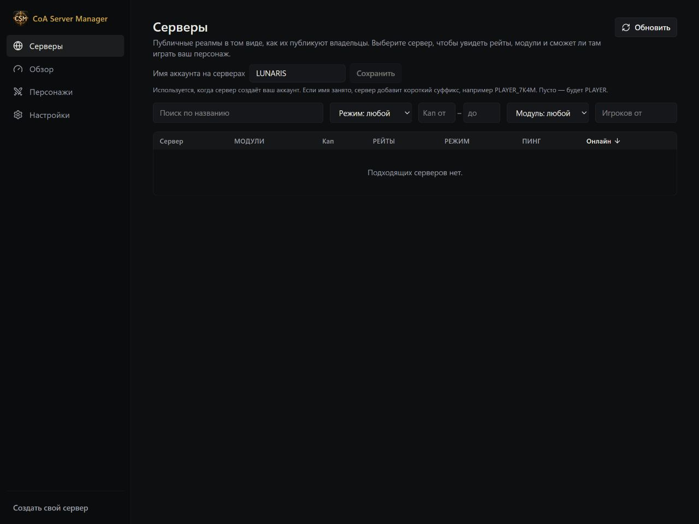

# Как сделать персонажа переносимым

[English](../PORTABLE-CHARACTERS.md) · **Русский** · [Deutsch](../de/PORTABLE-CHARACTERS.md) · [Français](../fr/PORTABLE-CHARACTERS.md) · [Español](../es/PORTABLE-CHARACTERS.md) · [简体中文](../zh-CN/PORTABLE-CHARACTERS.md)

**Переносимые персонажи — экспериментальная функция.** Она ещё развивается и может работать с ошибками.

Менеджер хранит сохранённого персонажа, с которым можно играть на совместимых CoA-реалмах.

## Первый переносимый персонаж

1. Выйдите из мира этим персонажем. Менеджер оставьте открытым.
2. Откройте **«Персонажи» (Characters)** → **«Сделать существующего персонажа переносимым» (Make an existing character portable)**.
3. Выберите доступный вам реалм, затем персонажа.
4. Нажмите **«Сделать переносимым» (Make portable)**. Персонаж появится в списке **«Ваши персонажи» (Your characters)**.

Если выбрать персонажа нельзя, рядом будет указана причина. Операцию могут блокировать персонаж-бот, активное испытание или некоторые неполученные награды. Создание переносимой копии не удаляет исходного персонажа с реалма.

## Персонаж с чужого реалма

1. В разделе **«Серверы» (Servers)** выберите реалм, на котором находится персонаж.
2. Нажмите **«Привязать существующий аккаунт» (Link an existing account)** и укажите свой аккаунт этого реалма.
3. Войдите на реалм в игре и останьтесь на экране выбора персонажа.
4. Вернитесь в менеджер через **Alt+Tab** и нажмите **Show my characters** — показать персонажей.
5. Выберите нужного персонажа и нажмите **«Сделать переносимым» (Make portable)**.
6. Дождитесь подтверждения и отметки **Portable**.

## Как играть

1. Найдите совместимый реалм: в режиме игрока — в разделе **«Серверы»**, при хостинге — в **«Игра с друзьями»**. Можно выбрать и уже подключённый к менеджеру реалм.
2. Выберите переносимого персонажа и прочитайте сведения о совместимости перед нажатием **Play**.
3. Выполните шаг с аккаунтом. Одни серверы создают его автоматически, для других нужен существующий аккаунт.
4. Запустите игру, когда менеджер сообщит, что персонаж готов.
5. Во время игры не закрывайте менеджер. После выхода из мира дождитесь завершения сохранения и только затем закрывайте приложение или переходите на другой реалм.

Если на реалме ниже максимальный уровень, персонаж может временно играть на пониженном уровне. Читайте предупреждения: неподдерживаемое содержимое откладывается, а не удаляется без уведомления. Само наличие менеджера не делает любой сервер совместимым с переносимыми персонажами.

## Сохранённые версии и конфликты

В **«Сохранённых версиях» (Saved versions)** видно, когда сохранялся прогресс. Если менеджер сообщает о конфликте, прочитайте его пояснение перед продолжением. Не играйте двумя копиями персонажа одновременно и сохраняйте обычные резервные копии сервера.

[Все гайды](README.md)
