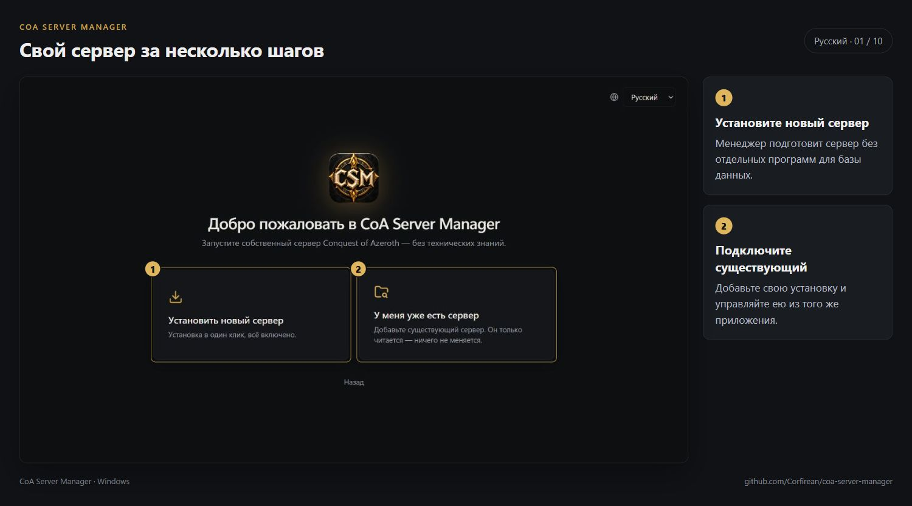
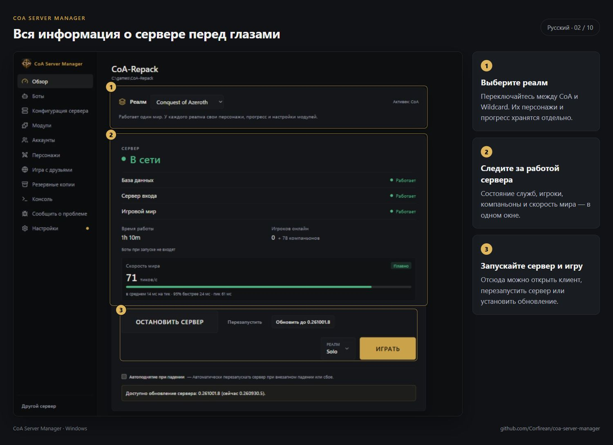
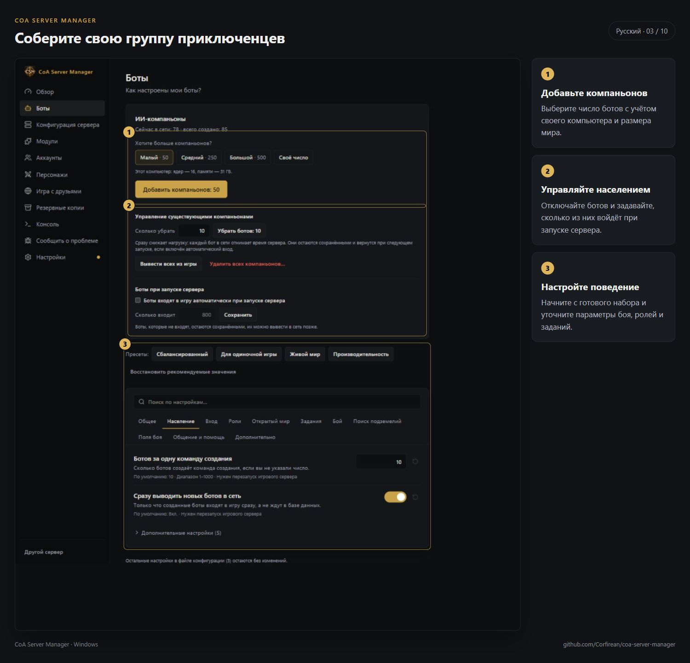
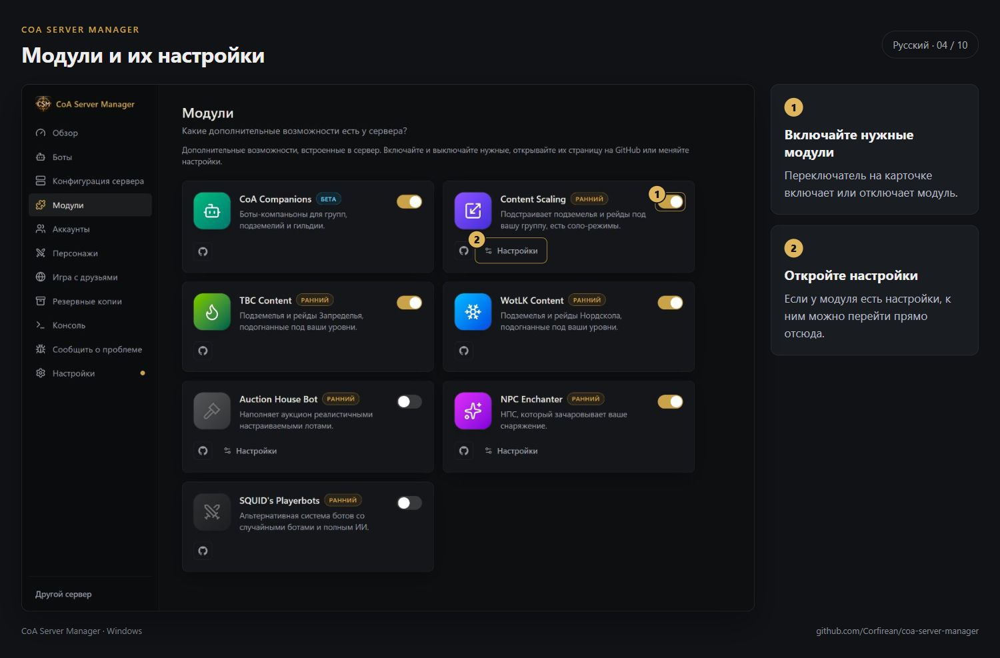
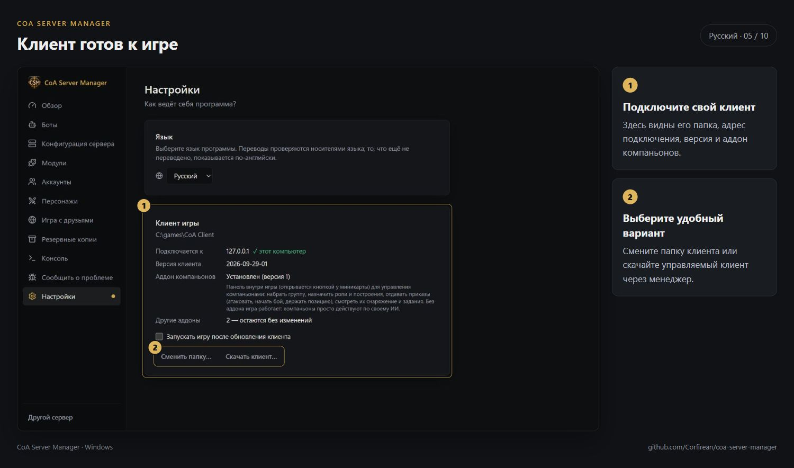
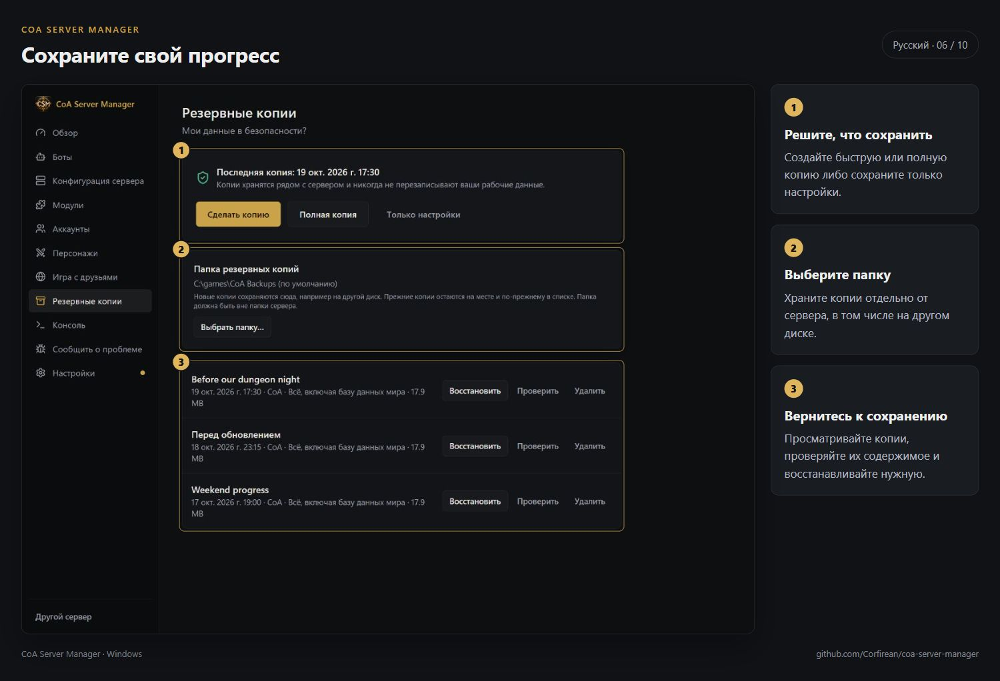
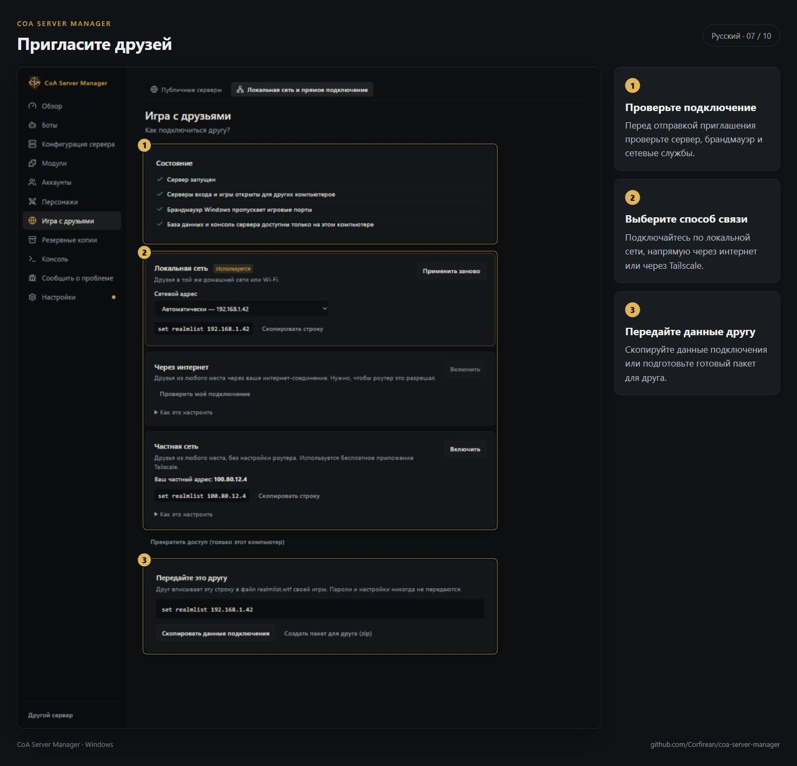
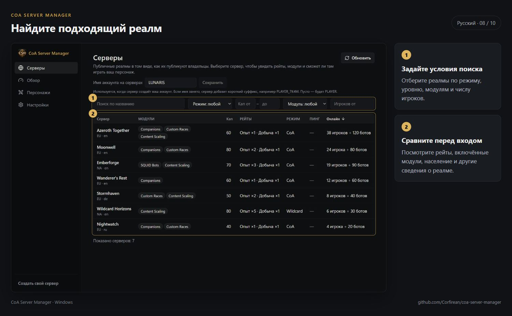
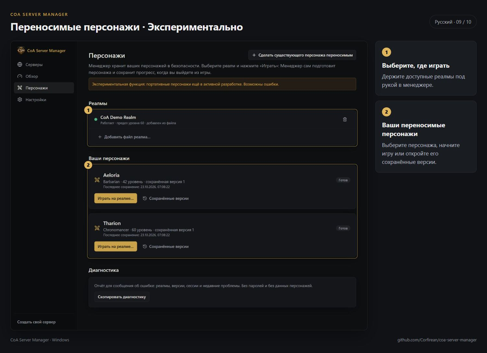
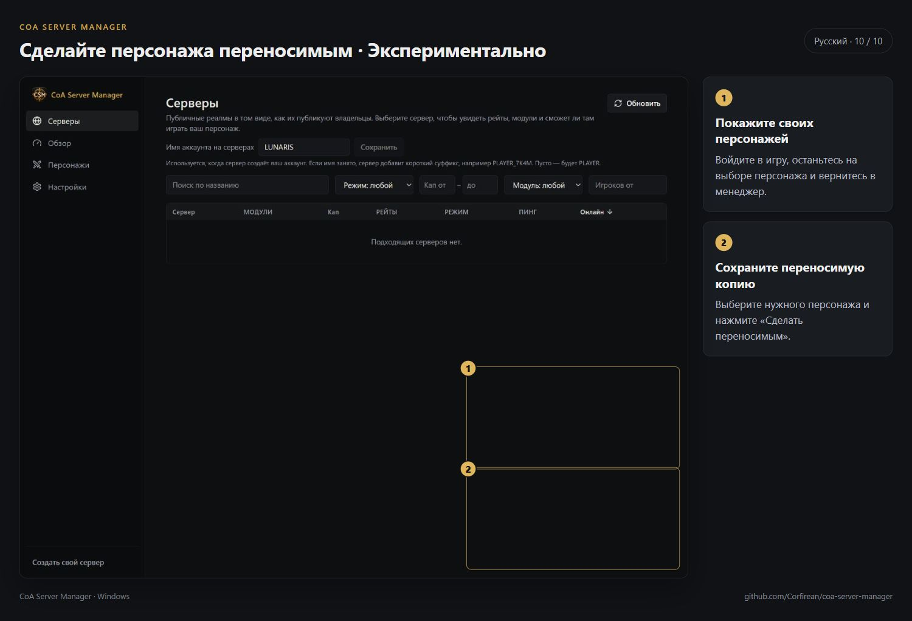

# CoA Server Manager — галерея

[English](../SCREENSHOTS.md) · **Русский** · [Deutsch](../de/SCREENSHOTS.md) · [Français](../fr/SCREENSHOTS.md) · [Español](../es/SCREENSHOTS.md) · [简体中文](../zh-CN/SCREENSHOTS.md)

На скриншотах показан русский интерфейс.

### Свой сервер за несколько шагов

### Вся информация о сервере перед глазами

### Соберите свою группу приключенцев

### Модули и их настройки

### Клиент готов к игре

### Сохраните свой прогресс

### Пригласите друзей

### Найдите подходящий реалм

### Переносимые персонажи — экспериментально

### Сделайте существующего персонажа переносимым — экспериментально

[Все гайды](README.md)
