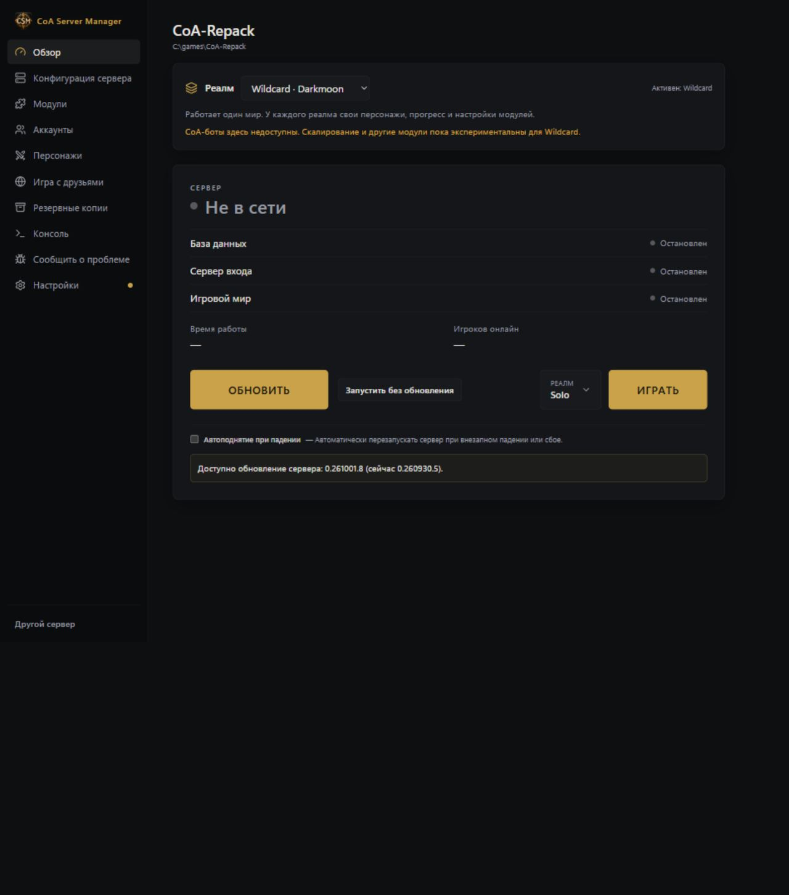
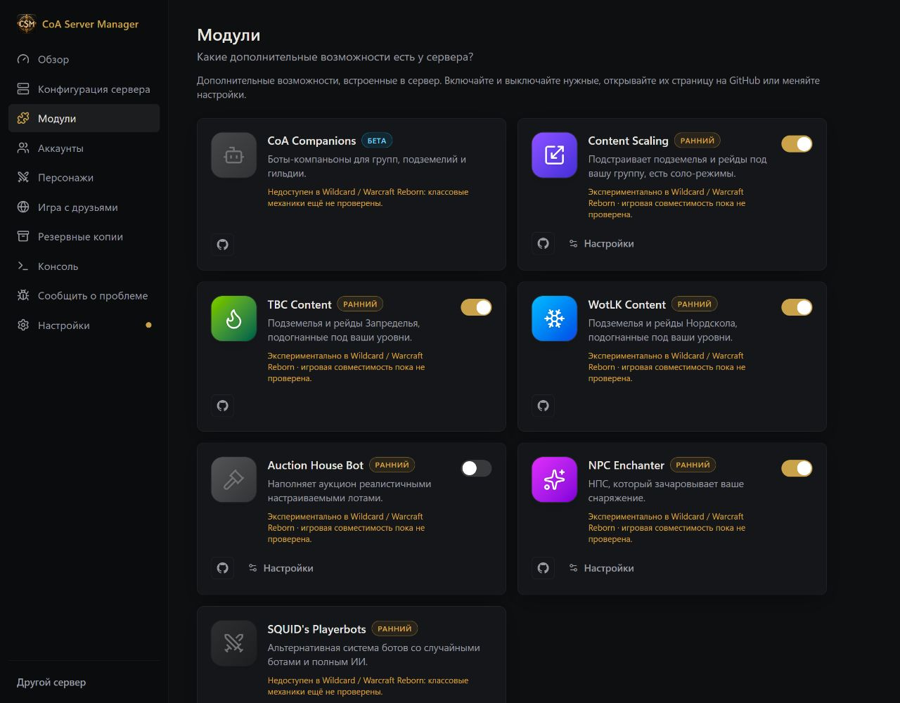

# Реалмы CoA и Wildcard

[English](../WILDCARD.md) · **Русский** · [Deutsch](../de/WILDCARD.md) · [Français](../fr/WILDCARD.md) · [Español](../es/WILDCARD.md) · [简体中文](../zh-CN/WILDCARD.md)

В разделе **«Обзор» (Overview)** можно выбрать CoA или Wildcard. Сервер должен поддерживать Wildcard и иметь необходимые обновления базы. При несовместимой сборке, занятом ID реалма `2` или уже существующей целевой базе менеджер остановит создание, чтобы не перезаписать данные.

При первом переключении мир CoA копируется в `acore_world_wildcard`, а `acore_characters_wildcard` создаётся с пустым списком персонажей и начальными служебными данными. Персонажи, коллекции карт и прогресс не копируются. Аккаунты остаются общими в `acore_auth`. В обычном режиме реалмы `1` и `2` используют один игровой порт: работает выбранный реалм, второй отображается выключенным. Переключение работающего сервера корректно останавливает его и запускает выбранный профиль.

Настройки профилей хранятся в `Settings/realm-profiles`. Если переключение прервалось, журнал позволяет восстановить предыдущую конфигурацию. Компаньоны CoA недоступны в Wildcard. Content Scaling и другие дополнительные модули сохраняют свои настройки, но совместимость отмечена как экспериментальная: поведение классов требует отдельных игровых проверок. При возвращении в CoA восстанавливаются настройки его модулей.

Быстрые копии и копии баз включают обе базы персонажей и общие аккаунты; полные — также оба мира. В точке восстановления указан её реалм: выберите его перед восстановлением. Обновления применяются к обоим реалмам, а общая база аккаунтов обновляется один раз. После замены серверного лаунчера менеджер повторно настраивает маршрутизацию реалмов перед запуском.

[Все гайды](README.md) · [Как запустить оба реалма](REPAIR_AND_REALMS.md)
