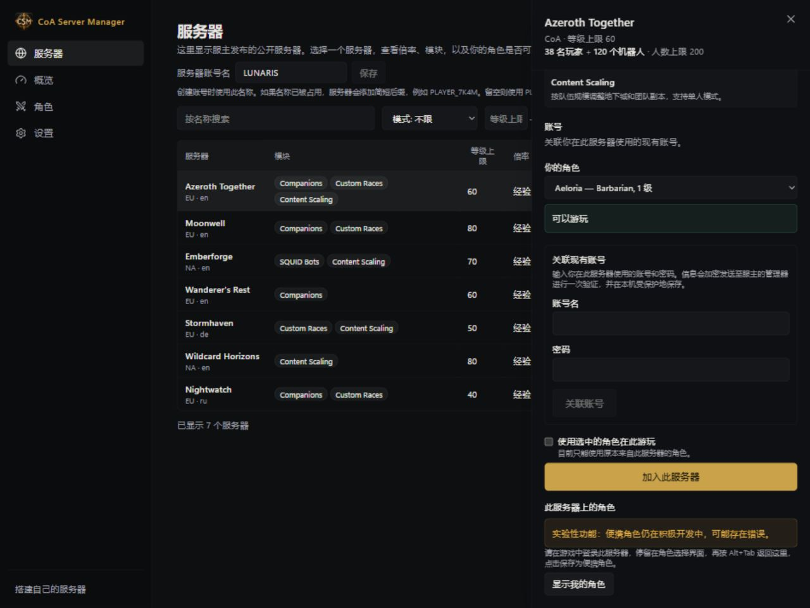
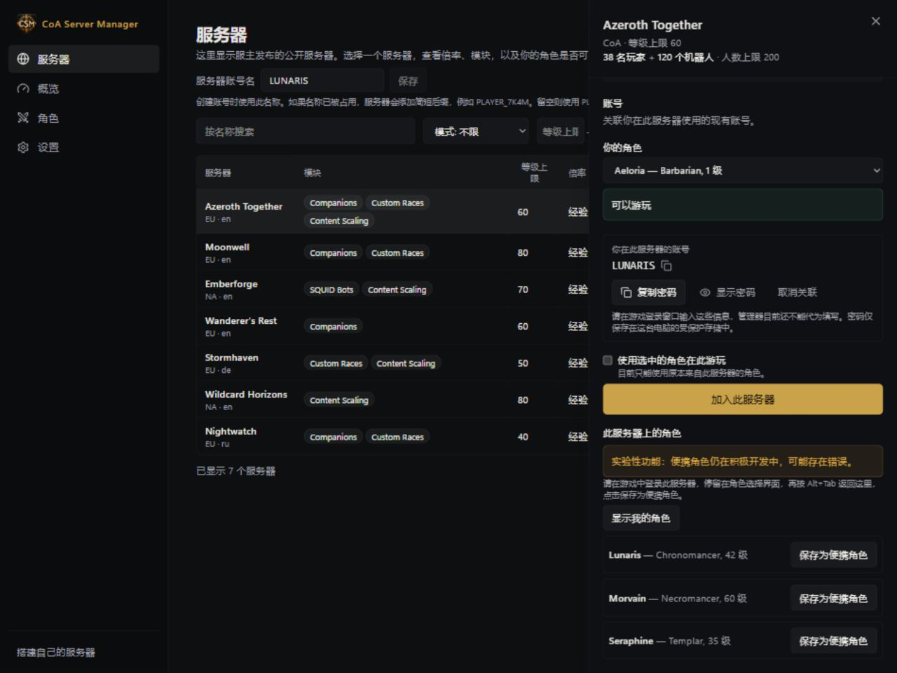
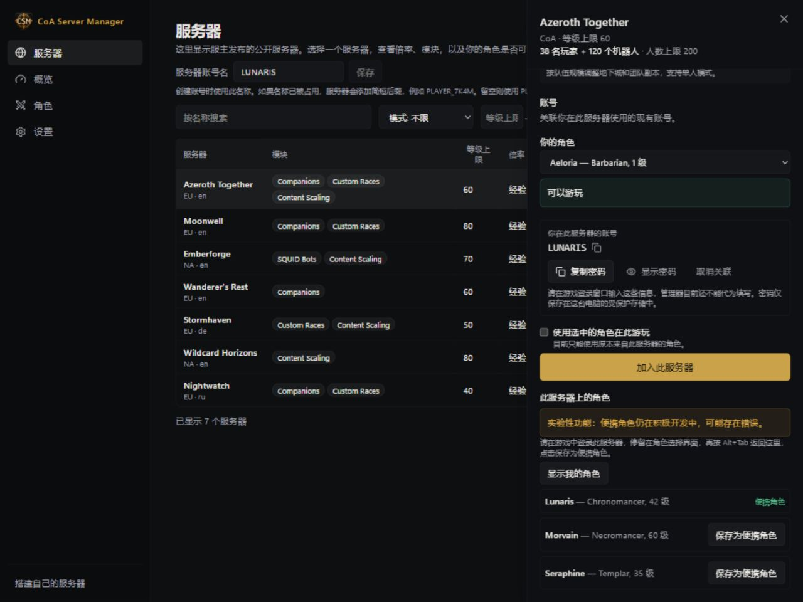

# 将角色保存为便携角色

[English](../PORTABLE-CHARACTERS.md) · [Русский](../ru/PORTABLE-CHARACTERS.md) · [Deutsch](../de/PORTABLE-CHARACTERS.md) · [Français](../fr/PORTABLE-CHARACTERS.md) · [Español](../es/PORTABLE-CHARACTERS.md) · **简体中文**

**便携角色是一项实验性功能。** 目前仍在开发中，使用时可能遇到问题。

管理器可以保存角色副本，让你带着这个角色在兼容的 CoA 服务器上游玩。

## 创建第一个便携角色

1. 在游戏中让该角色退出世界，保持管理器开启。
2. 打开**角色（Characters）**，选择 **将现有角色保存为便携角色 (Make an existing character portable)**。
3. 选择有权访问的服务器，再选择角色。
4. 点击 **保存为便携角色 (Make portable)**。完成后，角色会出现在 **你的角色 (Your characters)** 中。

如果无法选择某个角色，请查看旁边的原因。机器人角色、进行中的挑战，以及部分尚未领取的奖励都可能阻止转换。创建便携副本不会删除原服务器上的角色。

## 从其他服务器保存角色

1. 在**服务器（Servers）**页面中选择角色所在的服务器。
2. 点击 **关联现有账号 (Link an existing account)**，填写你在该服务器使用的现有账号。
3. 在游戏中登录该服务器，并停留在角色选择界面。
4. 用 **Alt+Tab** 返回管理器，点击 **显示我的角色 (Show my characters)**。
5. 找到目标角色，点击 **保存为便携角色 (Make portable)**。
6. 等待成功提示，以及 **Portable** 标记出现。

## 使用便携角色游玩

1. 查找兼容服务器：玩家模式使用 **Servers**，服主模式使用**好友联机（Play with Friends）**。也可以选择管理器中已有的服务器。
2. 选择便携角色，在点击 **Play** 前阅读兼容性提示。
3. 按提示处理账号。有些服务器会为你创建账号，有些则要求使用现有账号。
4. 等待管理器提示角色已准备就绪，再启动游戏。
5. 游玩时保持管理器开启。退出世界后，先等待进度保存完成，再关闭管理器或切换服务器。

如果目标服务器的等级上限更低，角色可能会临时以较低等级游玩。请阅读提示：不支持的内容会暂时保留，不会在没有提示的情况下直接丢弃。服务器本身必须兼容；仅安装管理器并不能让所有服务器都支持便携角色。

## 历史存档与冲突

在 **历史存档 (Saved versions)** 中查看进度保存时间。如果出现冲突，先阅读管理器的说明再继续。不要同时游玩同一角色的两个副本，也请保留常规服务器备份。

[全部指南](README.md)
