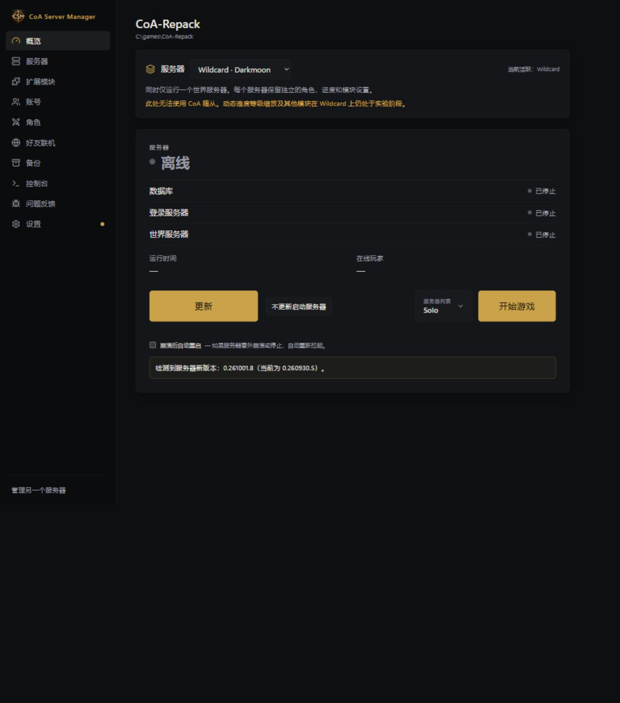
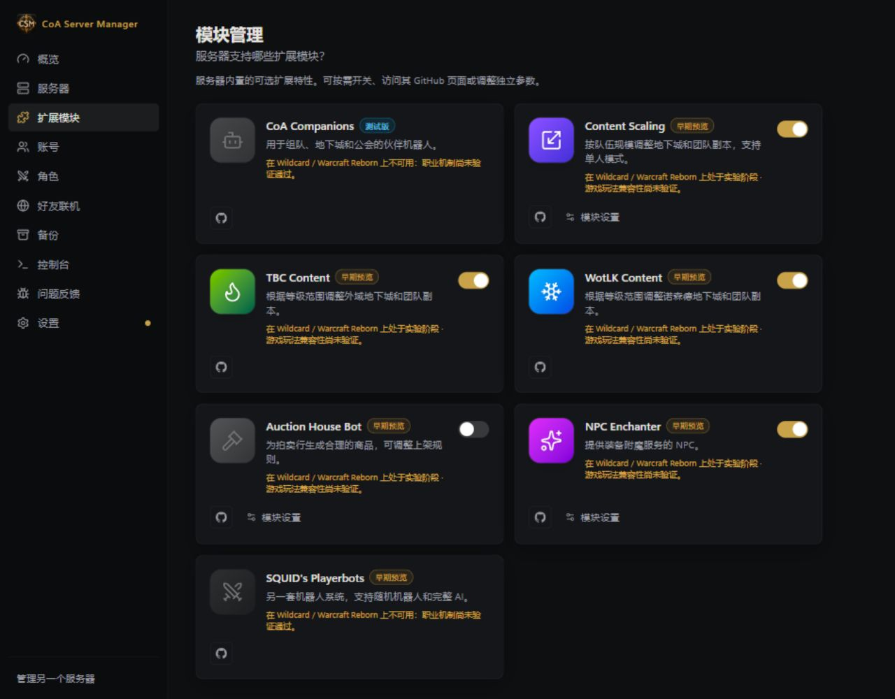

# CoA 与 Wildcard 模式

[English](../WILDCARD.md) · [Русский](../ru/WILDCARD.md) · [Deutsch](../de/WILDCARD.md) · [Français](../fr/WILDCARD.md) · [Español](../es/WILDCARD.md) · **简体中文**

在**概览（Overview）**中选择 CoA 或 Wildcard。服务器必须支持 Wildcard，数据库也必须完成相应迁移。如果服务端不兼容、服务器 ID `2` 已被占用，或目标数据库已存在，管理器会停止创建，避免覆盖数据。

首次切换会把 CoA 世界复制到 `acore_world_wildcard`，并根据角色数据库结构及必要的初始数据创建 `acore_characters_wildcard`。已有角色、卡牌收藏和进度不会复制。账号继续共用 `acore_auth`。默认单模式运行时，ID 为 `1` 和 `2` 的服务器共用世界端口，只有选中的模式运行，另一个显示离线。运行中切换会先正常关闭服务器，再使用所选模式重新启动。

模式配置保存在 `Settings/realm-profiles`。如果切换中断，可以根据操作日志恢复之前的配置。Wildcard 不支持 CoA 伙伴机器人。Content Scaling 和其他可选模块会保留设置，但兼容性仍属实验性质，职业机制需要单独进行游戏内验证。切换回 CoA 后，会恢复 CoA 的模块设置。

快速备份和数据库备份包括两个角色数据库及共用账号；完整备份还包括两个世界。恢复前，请先选择恢复点所记录的模式。服务器更新会处理两个模式，共用账号数据库只更新一次。如果更新替换了服务器启动器，管理器会在下次启动前重新应用模式适配。

[全部指南](README.md) · [同时运行两个模式](REPAIR_AND_REALMS.md)
